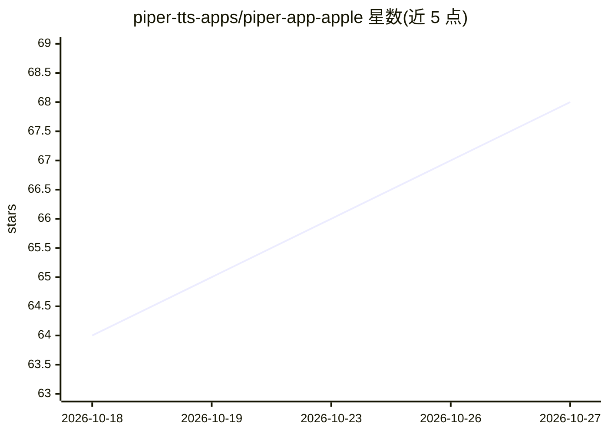

# piper-tts-apps/piper-app-apple

⭐ 68 · Swift · GPL-3.0 · 推送 2026-10-25 · [GitHub](https://github.com/piper-tts-apps/piper-app-apple) · 组织维护

**Piper 神经 TTS 的 iOS/macOS 官方应用移植**

将开源神经网络文本转语音引擎 Piper 以原生应用形式带到 iOS 与 macOS，提供设备端离线合成，已上架 App Store 并开放 TestFlight 公测。工程主体为 Swift/Tuist 项目：用 mise 管理开发工具，生成 Xcode workspace 后构建，包含主应用与 Audio Unit 扩展（可作为系统音频单元调用）。源码采用 MIT 许可，捆绑资源为 GPL-3.0。构建需 iOS 18+/macOS 13.3+ 与 Xcode 26+。

## 筛选速览

| 维度 | 判定 | 备注 |
|---|---|---|
| AI 角色 | `ai-native` | 本体是模型或模型工具 |
| 许可风险 | `viral` | GPL-3.0 |
| 部署形态 | `None` |  |
| 模型依赖 | — | README 未给出锁定关系 |
| 硬件要求 | — | 无带数字的原话,不猜 |
| 安装摩擦 | `low` | 无编译、无系统依赖或容器化 |
| 成熟度 | `idea` | |

## 能力要点

- Piper 离线神经 TTS 在 iOS/macOS 上运行
- 已上架 App Store，另提供 TestFlight Beta
- 含 PiperTTS Audio Unit 扩展
- Tuist + SPM + mise 的工程构建流程

## 适用场景

- 在 iPhone 或 Mac 上离线合成语音
- 通过 Audio Unit 扩展在其他应用中使用 Piper 语音
- 参与 TestFlight 提前试用新功能

## 场景标签

`语音合成` · 领域:内容生成

## 证据(README 行号)

> L6:  Experience high-quality offline neural text-to-speech directly on your device.

## 星数曲线

2026-10-18 64 → 2026-10-27 68（+4）

---
*卡片 v1 · prompt 1.4 · 生成 2026-10-24 · 置信度 high · 依据 README sha `bdf79746eb34` · [字段定义](../../DATASET.md)*
