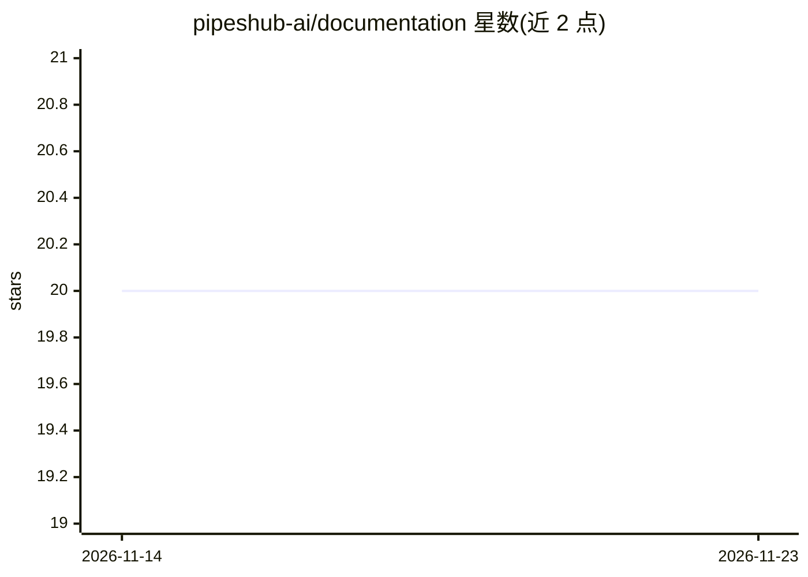

# pipeshub-ai/documentation

⭐ 20 · MDX · 推送 2026-11-22 · [GitHub](https://github.com/pipeshub-ai/documentation) · [官网](https://docs.pipeshub.com) · 组织维护

**PipesHub（AI 搜索/上下文层）官方文档站源码仓库**

docs.pipeshub.com 文档站的源码仓库，基于 Mintlify 构建：页面为 .mdx 文件，导航与站点配置存于 docs.json。本地可通过 npm 全局安装 mint CLI 运行 mint dev 预览（localhost:3000），并用 mint broken-links 检查内部链接，命令需在仓库根目录执行。文档主题为开源企业级 AI 搜索与 AI agent 上下文层，标签涉及 enterprise-search、mcp、rag。面向该产品用户与文档贡献者。

## 筛选速览

| 维度 | 判定 | 备注 |
|---|---|---|
| AI 角色 | `ai-knowledge` | 知识聚合/清单类 |
| 许可风险 | `none` | — |
| 部署形态 | `library` | 以包/库形式分发 |
| 模型依赖 | — | README 未给出锁定关系 |
| 硬件要求 | — | 无带数字的原话,不猜 |
| 安装摩擦 | `low` | 无编译、无系统依赖或容器化 |
| 成熟度 | — | 结构信号不足 |

## 能力要点

- Mintlify 构建的文档站源码（.mdx 页面 + docs.json 配置）
- 提供 mint dev 本地预览与 broken-links 链接检查命令

## 适用场景

- 查阅 PipesHub 企业 AI 搜索与 MCP/RAG 相关文档
- 为该文档站提交贡献或本地预览改动
- 检查文档内部链接有效性

## 场景标签

 · 领域:AI 基础设施/企业搜索文档

## 证据(README 行号)

> L1: # PipesHub documentation
> L3: Source for docs.pipeshub.com, built with Mintlify. Pages are `.mdx` files; navigation and site settings are in `docs

## 星数曲线

2026-11-14 20 → 2026-11-23 20（+0）

---
*卡片 v1 · prompt 1.4 · 生成 2026-11-18 · 置信度 mid · 依据 README sha `4b250ca5211b` · [字段定义](../../DATASET.md)*
