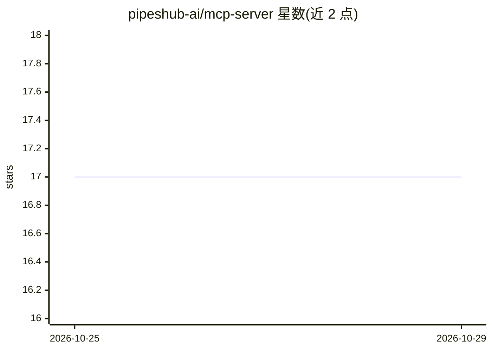

# pipeshub-ai/mcp-server

⭐ 17 · TypeScript · Apache-2.0 · 推送 2026-10-28 · [GitHub](https://github.com/pipeshub-ai/mcp-server) · [官网](https://pipeshub.com/) · 组织维护

**PipesHub 的远程 MCP 服务器：让 MCP 客户端接入企业搜索与 RAG**

PipesHub 官方的本地/远程 MCP 服务器组件包，通过 Streamable HTTP 在 /mcp 端点暴露 pipeshub_search、pipeshub_chat、pipeshub_get_record_content 等 7+ 个工具，供 Cursor、Claude Code、Gemini CLI、Codex CLI、Claude.ai Web 与 LibreChat 等 MCP 客户端以静态 OAuth 凭据或 bearer token 连接，从 Jira、Slack、GitHub、Drive 等来源按各人权限检索回答。前置条件为一个运行中的 PipesHub 实例（Cloud 或自托管 Docker）及在管理端创建的 OAuth 应用；scope 由发现端点列出并受 MCP_SCOPES 环境变量上限约束。另提供 Claude Code 插件安装与 npx skills 技能安装方式。

## 筛选速览

| 维度 | 判定 | 备注 |
|---|---|---|
| AI 角色 | `ai-ecosystem` | LLM/agent 周边工具 |
| 许可风险 | `permissive` | Apache-2.0 |
| 部署形态 | `library` | 以包/库形式分发 |
| 模型依赖 | — | README 未给出锁定关系 |
| 硬件要求 | — | 无带数字的原话,不猜 |
| 安装摩擦 | `low` | 无编译、无系统依赖或容器化 |
| 成熟度 | — | 结构信号不足 |

## 能力要点

- 通过 /.well-known/oauth-protected-resource/mcp 发现端点自动发现 OAuth 授权与令牌端点
- 暴露 pipeshub_search / pipeshub_chat / pipeshub_directory 等 MCP 工具，支持细粒度 scope 控制
- 覆盖 Cursor、Claude Code、Gemini CLI、Codex CLI、Claude.ai Web、LibreChat 六类客户端的接入配置
- 提供 Claude Code 插件与 npx skills add 两种技能/插件安装途径

## 适用场景

- 在 Cursor 或 Claude Code 中对我所在企业的 Jira、Slack、GitHub、Drive 内容做统一搜索
- 自托管 PipesHub 后为团队 MCP 客户端配置带权限隔离的知识接入
- 通过 scope 裁剪限制 MCP 客户端可调用的工具范围

## 场景标签

`RAG` `语义搜索` · 领域:知识与检索

## 证据(README 行号)

> L5: PipesHub exposes a remote MCP endpoint over **Streamable HTTP** at `/mcp`. MCP Clients connect to this endpoint dire
> L15: > **Looking for the tool reference?** See TOOLS.md for descriptions, arguments, and a decision guide for each tool 

## 星数曲线

2026-10-25 17 → 2026-10-29 17（+0）

---
*卡片 v1 · prompt 1.4 · 生成 2026-10-29 · 置信度 high · 依据 README sha `c7d5388d17c5` · [字段定义](../../DATASET.md)*
