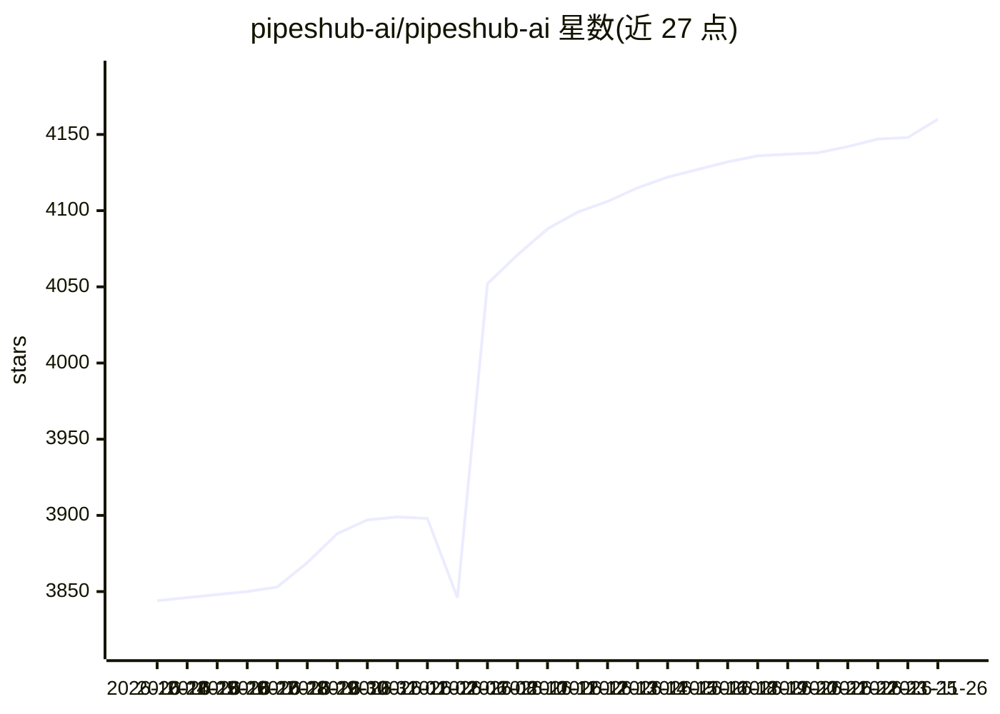

# pipeshub-ai/pipeshub-ai

⭐ 4,160 · Python · Apache-2.0 · 推送 2026-11-25 · [GitHub](https://github.com/pipeshub-ai/pipeshub-ai) · [官网](https://pipeshub.com) · 组织维护

**为企业与 agent 提供跨 50+ 数据源、带权限与引用的统一检索层**

PipesHub 是一个开源的企业上下文层：通过连接器同步 Slack、Google Drive、GitHub、Microsoft 365、Jira 等 50+ 系统的内容及其权限，建立索引与知识图谱后，以 agent 循环方式（混合检索、grep、图谱导航、全文阅读）回答问题并给出块级引用。面向企业员工与企业 agent，可通过 MCP、Node.js/Python/Go SDK、内置 agent 使用；支持 Docker Compose 自托管或 PipesHub Cloud 托管。模型可自选并可部署在用户 VPC 内。

## 筛选速览

| 维度 | 判定 | 备注 |
|---|---|---|
| AI 角色 | `ai-ecosystem` | LLM/agent 周边工具 |
| 许可风险 | `permissive` | Apache-2.0 |
| 部署形态 | `self-host` | docker 或自建部署 |
| 模型依赖 | — | README 未给出锁定关系 |
| 硬件要求 | — | 无带数字的原话,不猜 |
| 安装摩擦 | `low` | 无编译、无系统依赖或容器化 |
| 成熟度 | — | 结构信号不足 |

## 能力要点

- 50+ 企业连接器，索引时同步源系统权限并在每次工具调用时校验
- agent 循环检索：混合搜索、grep、知识图谱导航、全文阅读
- 答案带块级引用（表格单元格、行、代码行等），剔除虚构引用
- 提供 MCP Server 与 Python/TypeScript/Go SDK 供自建应用接入

## 适用场景

- 让 Claude Code、Cursor 等编码助手检索公司内部知识并按本人权限过滤
- 搭建跨多个业务系统的企业搜索与问答入口
- 通过 SDK 在自有应用中嵌入带引用的权限感知检索
- 用无代码方式构建执行企业操作的 agent

## 场景标签

`RAG` · 领域:知识与检索

## 证据(README 行号)

> L3:  An open-source context layer for AI agents and an enterprise search platform
> L57: PipesHub builds a **unified context layer** across documents, conversations, structured data, wikis, tickets and co
> L229: Use PipesHub with any MCP-compatible client to bring your enterprise context into AI workflows. Check the README f

## 星数曲线

2026-10-24 3,844 → 2026-11-26 4,160（+316）

---
*卡片 v1 · prompt 1.4 · 生成 2026-11-26 · 置信度 high · 依据 README sha `87c7a25d411d` · [字段定义](../../DATASET.md)*
