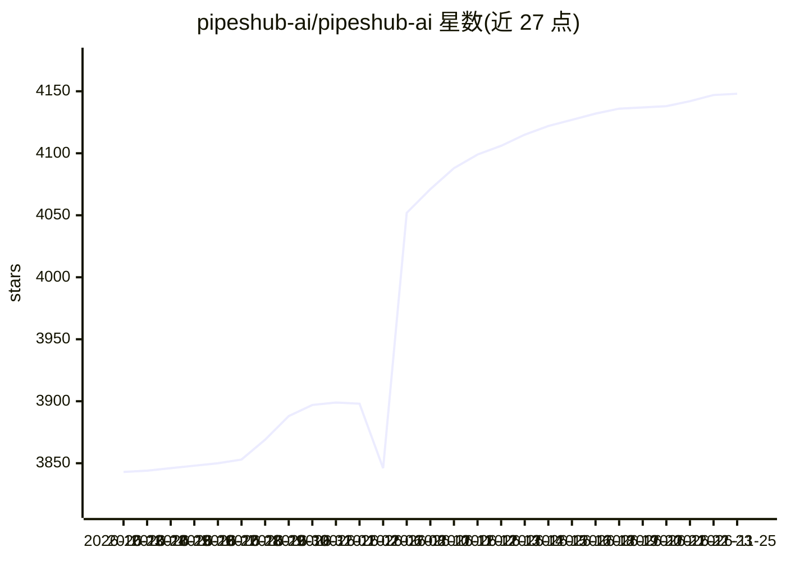

# pipeshub-ai/pipeshub-ai

⭐ 4,148 · Python · Apache-2.0 · 推送 2026-11-23 · [GitHub](https://github.com/pipeshub-ai/pipeshub-ai) · [官网](https://pipeshub.com) · 组织维护 · 中文 README

**企业知识上下文层：为人与 AI agent 提供带权限与引用的跨源搜索**

PipesHub 是连接企业业务系统的开源上下文层：通过 50+ 连接器同步 Slack、Google Drive、Jira、GitHub、Microsoft 365 等来源及其权限，索引管道对内容做解析、分块、嵌入并构建知识图谱。检索采用混合搜索、grep 匹配、知识图谱导航与全文阅读，由 agent 循环调用工具直至收集证据；每次工具调用按提问者权限过滤，回答附原文引用。通过 MCP、Python/TypeScript/Go SDK 与内置 agent 对外提供上下文，支持自托管 Docker Compose 部署或使用 PipesHub Cloud。

## 筛选速览

| 维度 | 判定 | 备注 |
|---|---|---|
| AI 角色 | `ai-ecosystem` | LLM/agent 周边工具 |
| 许可风险 | `permissive` | Apache-2.0 |
| 部署形态 | `self-host` | docker 或自建部署 |
| 模型依赖 | — | README 未给出锁定关系 |
| 硬件要求 | — | 无带数字的原话,不猜 |
| 安装摩擦 | `low` | 无编译、无系统依赖或容器化 |
| 成熟度 | — | 结构信号不足 |

## 能力要点

- 50+ 企业连接器，同步内容与源系统权限
- agent 循环检索：混合搜索、grep、知识图谱导航、全文阅读
- 回答带原始文档块引用，工具调用按用户权限过滤
- 通过 MCP 与 Python/TypeScript/Go SDK 向自有 agent 与应用开放同一上下文

## 适用场景

- 让 Claude Code、Cursor 等编码助手读取公司 Jira/Slack/GitHub/Drive 知识
- 为团队搭建带权限过滤和引用来源的企业搜索
- 在企业内部构建自托管 RAG 与深度研究 agent
- 给自有工作流或 MCP 客户端接入统一的检索上下文

## 场景标签

`RAG` `语义搜索` `知识图谱` `文档问答` · 领域:知识与检索

## 证据(README 行号)

> L3:  An open-source context layer for AI agents and an enterprise search platform
> L43: Connect Slack, Google Drive, GitHub, Microsoft 365, Notion and 50+ other systems. Search across them and get answer
> L199: over MCP for any compatible client, or through the SDKs when you are calling it

## 星数曲线

2026-10-23 3,843 → 2026-11-25 4,148（+305）

---
*卡片 v1 · prompt 1.4 · 生成 2026-11-23 · 置信度 high · 依据 README sha `f0b83427b1ab` · [字段定义](../../DATASET.md)*
