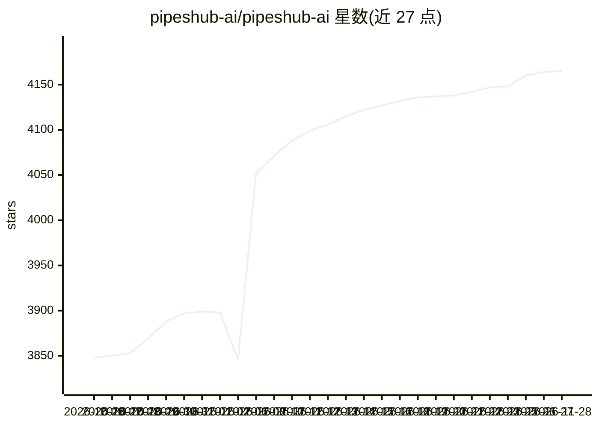

# pipeshub-ai/pipeshub-ai

⭐ 4,165 · Python · Apache-2.0 · 推送 2026-11-27 · [GitHub](https://github.com/pipeshub-ai/pipeshub-ai) · [官网](https://pipeshub.com) · 组织维护 · 中文 README

**为 AI 代理与企业搜索提供带权限感知的知识上下文层**

开源的企业上下文平台：通过 50+ 连接器同步 Slack、Google Drive、Jira、Confluence、GitHub、Microsoft 365 等系统及其权限，建立统一索引与知识图谱。查询由代理循环处理，组合混合检索、grep 模式匹配、图谱导航与全文阅读，每个工具调用按请求者权限过滤，答案带块级引用。可通过 MCP、Node/Python/Go SDK 将同一上下文提供给自己的代理与应用；支持 Docker 自托管或云版本，另设含多租户、SSO、审计日志的 Enterprise Edition。

## 筛选速览

| 维度 | 判定 | 备注 |
|---|---|---|
| AI 角色 | `ai-native` | 本体是模型或模型工具 |
| 许可风险 | `permissive` | Apache-2.0 |
| 部署形态 | `self-host` | docker 或自建部署 |
| 模型依赖 | local-ok | 支持本地模型 |
| 硬件要求 | — | 无带数字的原话,不猜 |
| 安装摩擦 | `low` | 无编译、无系统依赖或容器化 |
| 成熟度 | — | 结构信号不足 |

## 能力要点

- 50+ 企业系统连接器，同步数据并保留源系统权限
- 代理循环式检索：混合搜索 + grep + 知识图谱导航 + 全文阅读
- 块级引用答案，权限在每次工具调用时按请求者校验
- MCP Server 与 Node.js/Python/Go SDK 供外部代理和应用接入

## 适用场景

- 让 Claude Code、Cursor 等编码代理安全读取公司知识并带引用回答
- 为团队搭建跨 50+ 应用的统一企业搜索与问答
- 以 SDK 在自有应用中嵌入带权限过滤的检索
- 以无代码方式构建执行企业工具动作的代理

## 场景标签

`RAG` `语义搜索` `知识图谱` `文档问答` · 领域:知识与检索

## 证据(README 行号)

> L43: Connect Slack, Google Drive, GitHub, Microsoft 365, Notion and 50+ other systems. Search across them and get answer
> L57: PipesHub builds a **unified context layer** across documents, conversations, structured data, wikis, tickets and co
> L229: over MCP for any compatible client, or through the SDKs when you are calling it

## 星数曲线

2026-10-26 3,848 → 2026-11-28 4,165（+317）

---
*卡片 v1 · prompt 1.4 · 生成 2026-11-28 · 置信度 high · 依据 README sha `8d7e2e3266c9` · [字段定义](../../DATASET.md)*
