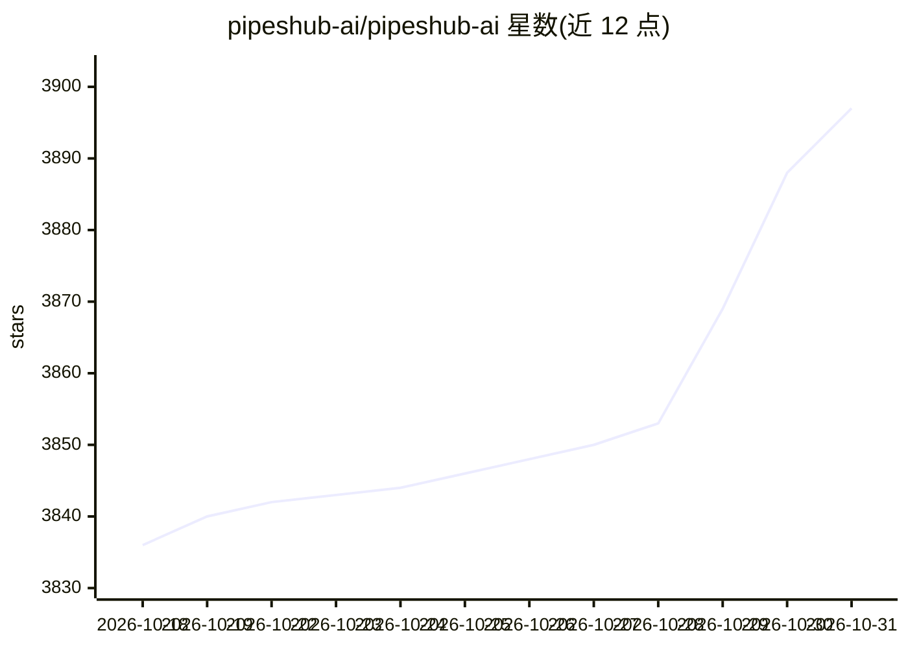

# pipeshub-ai/pipeshub-ai

⭐ 3,897 · Python · Apache-2.0 · 推送 2026-10-30 · [GitHub](https://github.com/pipeshub-ai/pipeshub-ai) · [官网](https://pipeshub.com) · 组织维护 · 中文 README

**企业知识上下文层：把 50+ 办公系统数据变为可搜索、带权限与引用的 agent 上下文**

开源（Apache 2.0）的职场 AI 平台：连接 Slack、Google Drive、GitHub、Microsoft 365、Notion 等 50+ 系统做实时/定时索引，提供权限感知搜索、带块级引用的回答、知识图谱检索（Neo4j/ArangoDB + Qdrant）、无代码 agent 与代码执行沙箱。通过 MCP、Python/TypeScript/Go SDK 向自有 agent 与 MCP 客户端供给同一份按人过滤的上下文，查询时按源系统权限解析。模型为自带（任意 LLM 提供商或本地 Ollama），默认本地嵌入服务，数据留在自有基础设施。部署方式为 Docker Compose 一条命令安装或从源码构建，由交互式安装器生成 .env 并拉起服务栈。

## 筛选速览

| 维度 | 判定 | 备注 |
|---|---|---|
| AI 角色 | `ai-ecosystem` | LLM/agent 周边工具 |
| 许可风险 | `permissive` | Apache-2.0 |
| 部署形态 | `self-host` | docker 或自建部署 |
| 模型依赖 | local-ok | 支持本地模型 |
| 硬件要求 | — | 无带数字的原话,不猜 |
| 安装摩擦 | `low` | 无编译、无系统依赖或容器化 |
| 成熟度 | — | 结构信号不足 |

## 能力要点

- 50+ 企业连接器，支持实时与定时索引
- 权限感知：agent 以个人身份连接，按源系统权限在查询时过滤
- MCP Server + Python/TypeScript/Go SDK 三种接入方式
- 知识图谱检索（Neo4j/ArangoDB）+ Qdrant 向量检索，Apache 2.0 可自托管

## 适用场景

- 让 Claude Code、Cursor 等编码助手安全引用公司 Jira/Slack/文档知识
- 搭建带引用与权限过滤的企业统一搜索
- 通过 SDK/MCP 把企业上下文接入自建 agent 与工作流

## 场景标签

`RAG` `语义搜索` `知识图谱` · 领域:知识与检索

## 证据(README 行号)

> L39: Connect Slack, Google Drive, GitHub, Microsoft 365, Notion and 50+ other systems. Search across them and get answer
> L169: over MCP for any compatible client, or through the SDKs when you are calling it

## 星数曲线

2026-10-18 3,836 → 2026-10-31 3,897（+61）

---
*卡片 v1 · prompt 1.4 · 生成 2026-10-20 · 置信度 high · 依据 README sha `bbae9eb7ade8` · [字段定义](../../DATASET.md)*
