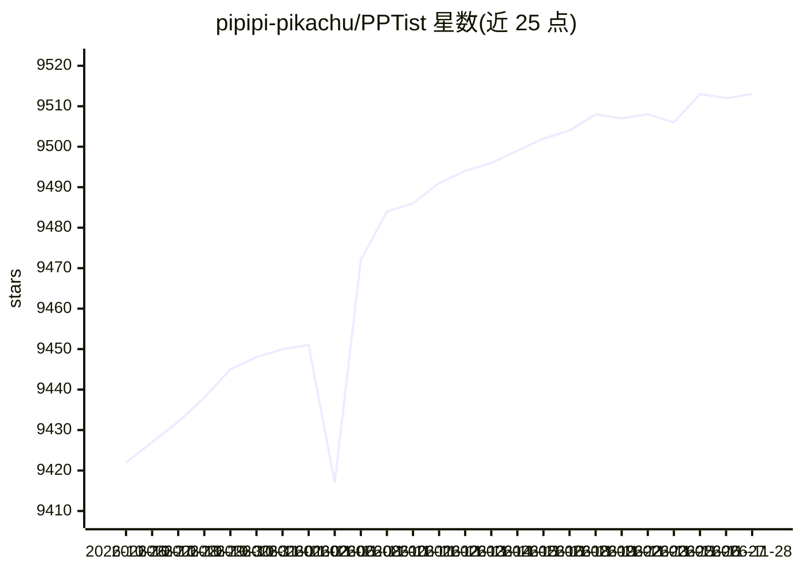

# pipipi-pikachu/PPTist

⭐ 9,513 · Vue · AGPL-3.0 · 推送 2026-11-27 · [GitHub](https://github.com/pipipi-pikachu/PPTist) · [官网](https://pipipi-pikachu.github.io/PPTist/) · 个人维护 · 中文 README

**给开发者的在线演示文稿编辑/放映 Web 应用**

基于 Vue 3 与 TypeScript 的 Web 端幻灯片编辑与放映应用，复刻 Office PowerPoint 常用功能：文本/图片/形状/线条/图表/表格/音视频/公式等元素编辑、页面管理、模板、切换与元素动画、演讲者工具、移动端基础编辑，支持导入导出 PPTX/JSON/图片/PDF。AI 相关功能为基于模板的 AIPPT 生成、AI 文本改写，并提供供 AI 直接生成页面数据的结构定义。面向有 Web 幻灯片开发需求的开发者，非开箱即用工具。

## 筛选速览

| 维度 | 判定 | 备注 |
|---|---|---|
| AI 角色 | `ai-enhanced` | 去掉 AI 部分产品仍成立 |
| 许可风险 | `dual` | AGPL-3.0 |
| 部署形态 | `library` | 以包/库形式分发 |
| 模型依赖 | — | README 未给出锁定关系 |
| 硬件要求 | — | 无带数字的原话,不猜 |
| 安装摩擦 | `low` | 无编译、无系统依赖或容器化 |
| 成熟度 | — | 结构信号不足 |

## 能力要点

- 浏览器内编辑与放映，支持文本/图片/形状/图表/表格/音视频/公式等元素
- 导入导出 PPTX（导入保真约85%+，导出约95%+）及 JSON/图片/PDF
- 模板化 AIPPT 生成，并提供 AI 直接生成页面数据的 schema 定义（AI_PPT_SCHEMA.md）
- 文本 AI 改写/扩写/缩写

## 适用场景

- 在此基础上定制开发在线演示/编辑产品
- 业务系统中在线预览与轻量审阅本地 PPTX 文件
- 接入 AI 生成结果后进行编辑与再加工

## 场景标签

 · 领域:办公/演示文稿工具

## 证据(README 行号)

> L11: **PowerPoint-ist（/'pauəpɔintist/）**, A web-based presentation (slideshow) application. This application replicates 
> L24: 1. The target audience for this project is developers with web slide development needs and basic web development ex
> L32: - **AI PPT Generation Tool** (Recommendation: ⭐⭐): This project supports a template-based AIPPT generation approach

## 星数曲线

2026-10-26 9,422 → 2026-11-28 9,513（+91）

---
*卡片 v1 · prompt 1.4 · 生成 2026-11-28 · 置信度 high · 依据 README sha `b0c0cf2279bc` · [字段定义](../../DATASET.md)*
