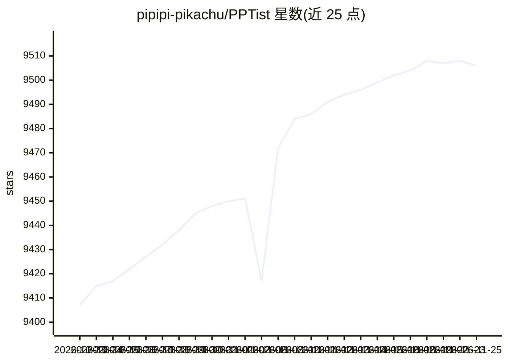

# pipipi-pikachu/PPTist

⭐ 9,506 · Vue · AGPL-3.0 · 推送 2026-11-22 · [GitHub](https://github.com/pipipi-pikachu/PPTist) · [官网](https://pipipi-pikachu.github.io/PPTist/) · 个人维护 · 中文 README

**面向开发者的开源在线 PPT 编辑与演示应用**

基于 Vue 3 与 TypeScript 的 Web 演示文稿应用，复刻 MS PowerPoint 常用功能：文本、图片、形状、线条、图表、表格、音视频、公式等元素的编辑，支持 PPTX 导入导出（标注保真度约 85%/95%）、JSON 格式、移动端基础编辑与放映工具。AI 相关能力为模板式 AIPPT 生成与文本的 AI 改写/扩写/缩写，需自行接入模型后端；项目定位为开发底座，不提供在线服务，不可开箱即用。目标读者为有 Web 幻灯片开发需求的开发者。

## 筛选速览

| 维度 | 判定 | 备注 |
|---|---|---|
| AI 角色 | `ai-enhanced` | 去掉 AI 部分产品仍成立 |
| 许可风险 | `dual` | AGPL-3.0 |
| 部署形态 | `library` | 以包/库形式分发 |
| 模型依赖 | — | README 未给出锁定关系 |
| 硬件要求 | — | 无带数字的原话,不猜 |
| 安装摩擦 | `low` | 无编译、无系统依赖或容器化 |
| 成熟度 | — | 结构信号不足 |

## 能力要点

- 支持文本/图片/形状/图表/表格/音视频/公式等元素编辑与在线放映
- 导入导出 PPTX（标称保真度约 85%/95%）、JSON、图片、PDF
- 模板式 AIPPT 生成，并提供 AI 直接生成页面数据的 schema（AI_PPT_SCHEMA.md）
- 移动端基础编辑与预览

## 适用场景

- 为低代码/H5 项目搭建在线幻灯片编辑能力
- 在 Web 应用中预览与轻量审阅 PPTX 文件
- 基于模板生成并二次编辑 AI 生成 PPT
- 自建在线演示/放映服务

## 场景标签

`AI 写作` · 领域:内容生成

## 证据(README 行号)

> L11: **PowerPoint-ist（/'pauəpɔintist/）**, A web-based presentation (slideshow) application. This application replicates 
> L29: > The core positioning of this project is a **Web Slide Editing/Presentation Application**. The following are the r
> L54: - Template-based AI PPT generation
> L108: - AI Rewrite/Expand/Abbreviate

## 星数曲线

2026-10-23 9,407 → 2026-11-25 9,506（+99）

---
*卡片 v1 · prompt 1.4 · 生成 2026-11-23 · 置信度 mid · 依据 README sha `d5806a45beed` · [字段定义](../../DATASET.md)*
