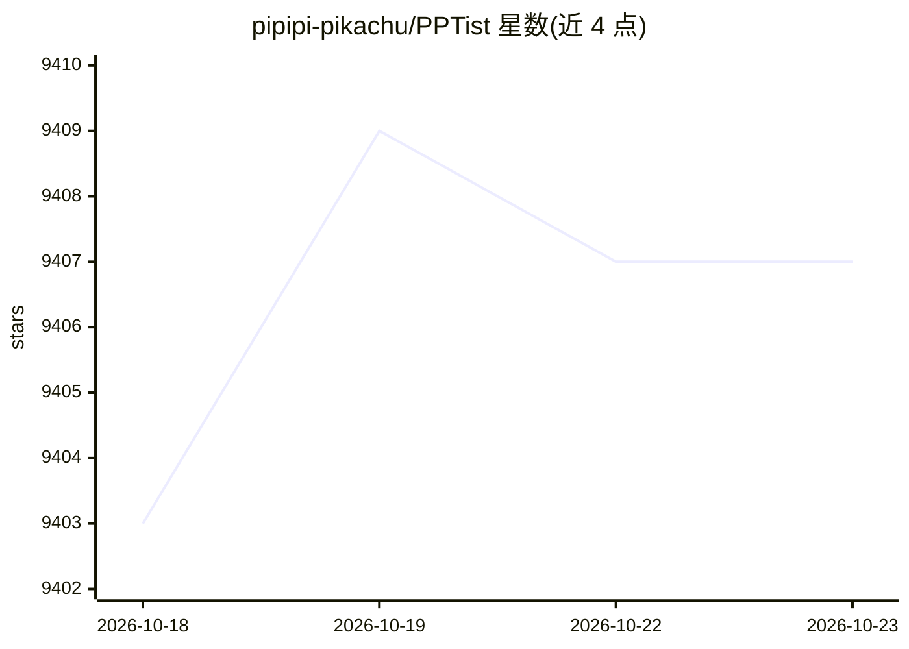

# pipipi-pikachu/PPTist

⭐ 9,407 · Vue · AGPL-3.0 · 推送 2026-10-10 · [GitHub](https://github.com/pipipi-pikachu/PPTist) · [官网](https://pipipi-pikachu.github.io/PPTist/) · 个人维护 · 中文 README

**面向 Web 开发者的在线 PPT 编辑与演示应用，支持 AIPPT 生成**

基于 Vue 3 与 TypeScript 构建的 Web 幻灯片编辑/演示应用，复现 Microsoft PowerPoint 常用功能：支持文本、图片、形状、图表、表格、音视频、公式等元素编辑，可导入/导出 PPTX（导入约 85%+ 保真度，导出约 95%+）、JSON、图片与 PDF。提供基于模板的 AIPPT 生成路径，并定义 AI 直接生成页面数据的数据结构（AI_PPT_SCHEMA.md）。目标用户是有 Web 开发经验的开发者，定位为二次开发基础而非开箱即用产品，含移动端基础编辑与预览、商用需遵循 AGPL-3.0 或获取独立商业授权。

## 筛选速览

| 维度 | 判定 | 备注 |
|---|---|---|
| AI 角色 | `ai-enhanced` | 去掉 AI 部分产品仍成立 |
| 许可风险 | `dual` | AGPL-3.0 |
| 部署形态 | `library` | 以包/库形式分发 |
| 模型依赖 | — | README 未给出锁定关系 |
| 硬件要求 | — | 无带数字的原话,不猜 |
| 安装摩擦 | `low` | 无编译、无系统依赖或容器化 |
| 成熟度 | — | 结构信号不足 |

## 能力要点

- Web 端复现 Office PPT 常用元素与功能，支持导入/导出 PPTX
- 基于模板的 AIPPT 生成，并提供 AI 直接生成页面数据的数据结构定义
- 放映模式含画笔标注、演讲者视图、计时器等工具
- 移动端支持基础编辑与预览播放

## 适用场景

- 构建自有品牌的在线演示/幻灯片编辑产品
- 作为 AIPPT 生成结果的承载、编辑与再加工基础
- 在线预览与轻量审阅本地 PPTX 文件

## 场景标签

`AI 写作` · 领域:内容生成

## 证据(README 行号)

> L10: # 🎨 PPTist
> L32: - **AI PPT Generation Tool** (Recommendation: ⭐⭐): This project supports a template-based AIPPT generation approach

## 星数曲线

2026-10-18 9,403 → 2026-10-23 9,407（+4）

---
*卡片 v1 · prompt 1.4 · 生成 2026-10-20 · 置信度 high · 依据 README sha `7c20c2679c89` · [字段定义](../../DATASET.md)*
