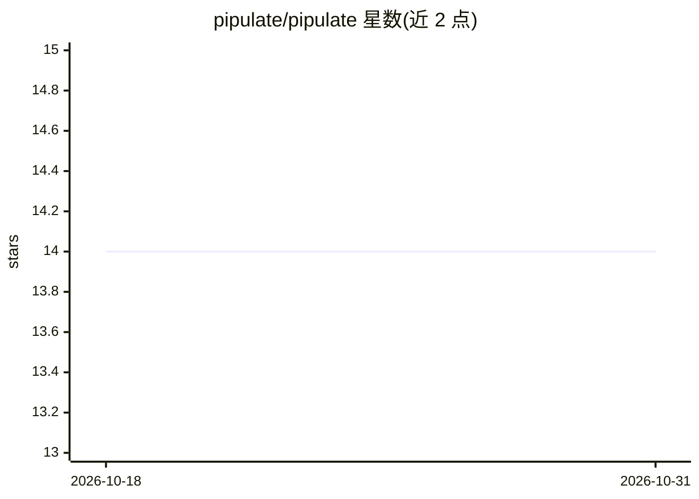

# pipulate/pipulate

⭐ 14 · Python · AGPL-3.0 · 推送 2026-10-30 · [GitHub](https://github.com/pipulate/pipulate) · [官网](https://pipulate.com/) · 个人维护

**本地优先的 AI 工作流框架：Nix 可复现环境中的分步 AI 工作流**

基于 FastHTML/HTMX 的单租户本地优先桌面应用框架：用 Nix Flakes 在项目文件夹内提供跨 macOS/Linux/Windows(WSL) 的可复现 Linux 环境，启动后得到本地 Web 应用（含 JupyterLab 与集成 AI 聊天）。核心机制是“AI On Rails”：领域专家定义分步工作流（如关键词研究、CSV 清洗、内容创作），由本地或云端任意 AI 在结构内执行，状态存于透明 SQLite 表；同时充当“context compiler”，把 AI 读取的文件与执行的命令堆叠成可重放的单文件。明确不使用 Docker，采用 Nix 派生路线；面向终端实践者与开发者两类用户。

## 筛选速览

| 维度 | 判定 | 备注 |
|---|---|---|
| AI 角色 | `ai-ecosystem` | LLM/agent 周边工具 |
| 许可风险 | `viral` | AGPL-3.0 |
| 部署形态 | `library` | 以包/库形式分发 |
| 模型依赖 | — | README 未给出锁定关系 |
| 硬件要求 | — | 无带数字的原话,不猜 |
| 安装摩擦 | `medium` | 含编译或系统依赖之一 |
| 成熟度 | — | 结构信号不足 |

## 能力要点

- Nix Flakes 提供跨平台位级可复现环境（flake.nix + flake.lock）
- 结构化分步工作流，可接入本地、云端或混合的任意 AI 模型
- 把 AI 读取的文件与命令输出汇编为可粘贴、可重放的单文件上下文
- Jupyter Notebook 可转为生产级分步工作流，状态存透明 SQLite

## 适用场景

- 非编程人员反复运行 AI 引导的 SEO/数据清洗/报告生成工作流
- 在本地硬件上运行 AI 工作流以保护数据隐私
- 开发者把 Jupyter 分析流程改造为可复用的引导式工作流

## 场景标签

`工作流自动化` · 领域:效率与自动化

## 证据(README 行号)

> L128: Pipulate is a **local-first, single-tenant desktop app framework** featuring AI-assisted, step-by-step workflows. 
> L106: **The Pipulate Approach:** Structured workflows that can leverage **any AI**--local, cloud, or hybrid--while maint

## 星数曲线

2026-10-18 14 → 2026-10-31 14（+0）

---
*卡片 v1 · prompt 1.4 · 生成 2026-10-31 · 置信度 mid · 依据 README sha `ded8a76faee1` · [字段定义](../../DATASET.md)*
