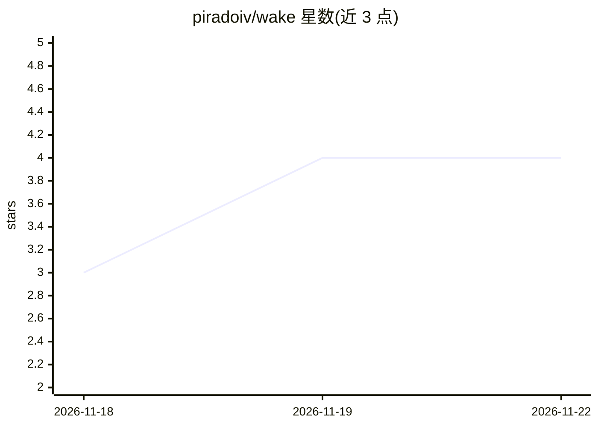

# piradoiv/wake

⭐ 4 · Xojo · MIT · 推送 2026-11-18 · [GitHub](https://github.com/piradoiv/wake) · [官网](https://github.com/piradoiv/wake/releases) · 个人维护

**读取 Claude Code 本地会话记录的 macOS 用量分析应用**

Wake 是一款开源免费的 macOS 原生应用，读取 Claude Code 在本机保存的会话转录文件，展示每条会话的时间线（提示、回答、工具调用、文件 diff），按天/项目/模型统计 token 用量并按动作类型分组，估算长会话因重复发送上下文产生的

## 筛选速览

| 维度 | 判定 | 备注 |
|---|---|---|
| AI 角色 | `ai-ecosystem` | LLM/agent 周边工具 |
| 许可风险 | `permissive` | MIT |
| 部署形态 | `desktop` | 安装包/桌面程序 |
| 模型依赖 | — | README 未给出锁定关系 |
| 硬件要求 | — | 无带数字的原话,不猜 |
| 安装摩擦 | `low` | 无编译、无系统依赖或容器化 |
| 成熟度 | — | 结构信号不足 |

## 能力要点

- 读取 Claude Code 本地转录文件，按动作类型拆解 token 去向
- 估算每轮因携带前文上下文产生的 carried 成本
- 支持全项目范围的提示/回答/命令输出全文搜索与会话实时监视
- 只读设计：不修改转录、不联网、无遥测

## 适用场景

- 排查 Claude Code 会话为何消耗大量 token 或触发用量上限
- 回放某次会话查看 agent 执行过的命令与文件改动
- 导出省钱建议清单贴回 issue 或 prompt 交给 agent

## 场景标签

`LLM 可观测性` · 领域:评测与运维

## 证据(README 行号)

> L16: Code keeps a full transcript of every session on your Mac, and Wake reads them
> L77: The Usage window (Cmd+U) shows your usage per day, project or model, and
> L143: |Claude Code|Supported|2.1.119 – 2.1.292|

## 星数曲线

2026-11-18 3 → 2026-11-22 4（+1）

---
*卡片 v1 · prompt 1.4 · 生成 2026-11-21 · 置信度 high · 依据 README sha `58e9eb46306a` · [字段定义](../../DATASET.md)*
