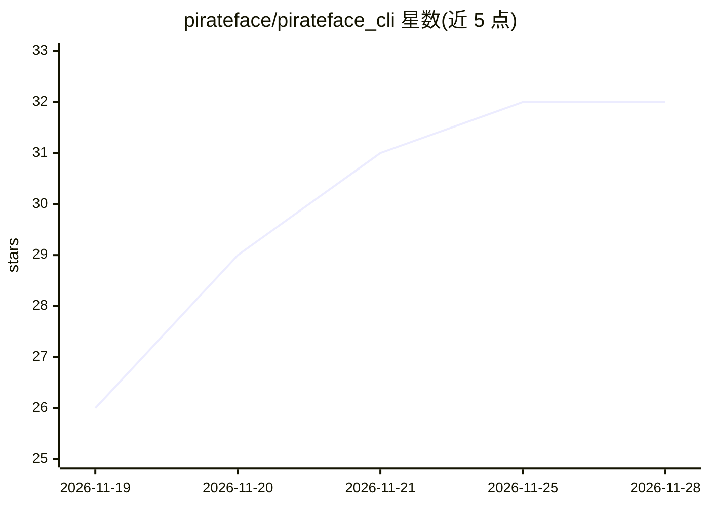

# pirateface/pirateface_cli

⭐ 32 · Python · MIT · 推送 2026-11-27 · [GitHub](https://github.com/pirateface/pirateface_cli) · [官网](https://pirateface.co) · 个人维护

**面向 AI 模型的 BitTorrent P2P 下载 CLI 工具**

pirateface_cli 提供 pf 命令行，通过 BitTorrent 从 Pirate Face 种子网络下载 Hugging Face 模型，并接入 HF 下载路径使 transformers、diffusers、hf download 等现有代码改由 P2P 拉取；每个文件按 Hugging Face 哈希校验，模型不在列表或节点停滞时回退到 HF 源，支持 PF_HF_FIRST 反转优先级。命令覆盖下载、做种、提交、任务构建（pf work）、磁力索引修复（pf restore）与本地索引镜像，站点不可用时可用本地分片索引继续从 swarm 下载。需要 Python 3.12/3.13。

## 筛选速览

| 维度 | 判定 | 备注 |
|---|---|---|
| AI 角色 | `ai-ecosystem` | LLM/agent 周边工具 |
| 许可风险 | `permissive` | MIT |
| 部署形态 | `library` | 以包/库形式分发 |
| 模型依赖 | local-ok | 支持本地模型 |
| 硬件要求 | — | 无带数字的原话,不猜 |
| 安装摩擦 | `low` | 无编译、无系统依赖或容器化 |
| 成熟度 | — | 结构信号不足 |

## 能力要点

- 通过下载钩子接管 transformers/diffusers/hf download 的下载路径，代码无需改动
- 每个文件按 Hugging Face 指纹校验，libtorrent 逐片哈希验证
- pf work 支持租约、断点续传与带宽/大小限制，模型字节不落盘
- 站点宕机时本地磁力索引分片副本仍可从 swarm 下载

## 适用场景

- 用 P2P 方式下载 Hugging Face 模型到本地缓存
- 把自己本地或非 HF 的模型做种并提交到网络
- 参与 pf work 队列任务为他人构建模型种子

## 场景标签

 · 领域:模型分发/开发工具

## 证据(README 行号)

> L3: Downloads HF models over BitTorrent from Pirate Face seeders. Your code stays the same.
> L17: Anything that downloads through HF (transformers, diffusers, `hf download`) now pulls from the swarm. Every file is

## 星数曲线

2026-11-19 26 → 2026-11-28 32（+6）

---
*卡片 v1 · prompt 1.4 · 生成 2026-11-19 · 置信度 high · 依据 README sha `205324e3a0c6` · [字段定义](../../DATASET.md)*
