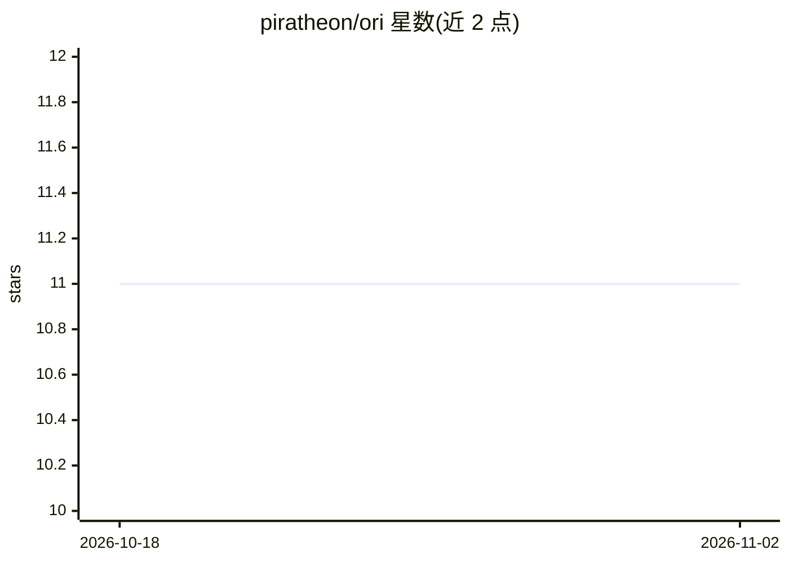

# piratheon/ori

⭐ 11 · C++ · GPL-3.0 · 推送 2026-09-19 · [GitHub](https://github.com/piratheon/ori) · 个人维护

**终端优先的 Linux AI 助手：TUI 与 Web GUI 接入多模型**

用 C++ 编写的终端 AI 助手，提供 Textual TUI 与本地 Web GUI（默认 8080 端口）两种界面，通过 OpenRouter 接入多个 LLM（Groq 与 G4F 计划支持）。面向开发者、高级用户与系统管理员。功能含需确认的 agentic 命令执行、带包管理（Orpm）的插件系统、git 快照与 /undo、RAG 记忆等。需 C++14 编译器、CMake 3.10+ 与 OpenRouter API key，从源码构建或经 AUR 安装；README 声明开发速度因维护者时间受限而放缓。

## 筛选速览

| 维度 | 判定 | 备注 |
|---|---|---|
| AI 角色 | `ai-native` | 本体是模型或模型工具 |
| 许可风险 | `viral` | GPL-3.0 |
| 部署形态 | `None` |  |
| 模型依赖 | locked-api |  |
| 硬件要求 | — | 无带数字的原话,不猜 |
| 安装摩擦 | `medium` | 含编译或系统依赖之一 |
| 成熟度 | `idea` | |

## 能力要点

- OpenRouter 接入多模型，自动重试网络错误与限流
- Orpm 插件系统与可扩展架构
- agentic 命令执行（需确认）与 git 快照 /undo
- TUI 与本地 Web GUI 双界面

## 适用场景

- 在终端里直接向 AI 提问或执行工作流
- 在项目目录中让 AI 辅助执行命令并可回滚
- 通过浏览器本地界面使用聊天与代码画布

## 场景标签

`AI 助手` · 领域:对话与助手

## 证据(README 行号)

> L7: > A terminal‑first AI assistant for Linux with both a Text User Interface (TUI) and a web-based Graphical User Inter
> L19: - **OpenRouter integration:** Connect to multiple AI models.

## 星数曲线

2026-10-18 11 → 2026-11-02 11（+0）

---
*卡片 v1 · prompt 1.4 · 生成 2026-11-01 · 置信度 high · 依据 README sha `078585d9017a` · [字段定义](../../DATASET.md)*
