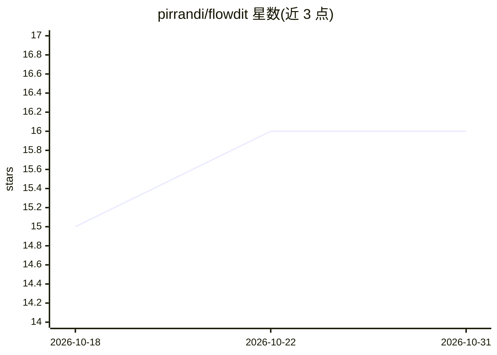

# pirrandi/flowdit

⭐ 16 · JavaScript · MIT · 推送 2026-10-28 · [GitHub](https://github.com/pirrandi/flowdit) · 个人维护

**自托管的渗透测试项目管理与报告平台，含自主 AI 扫描代理**

面向渗透测试人员与安全顾问的自托管平台：集中管理 findings、目标、方法论清单（OWASP WSTG、PortSwigger 实验室跟踪）与团队协作，提供只读客户门户（按联系人分发链接、工单系统）和 PDF/DOCX 报告导出。内置自主 AI agent，可独立执行侦察与测试，风险操作需人工批准，支持多模型后端（Groq、Anthropic、DeepSeek、Kimi 或本地 OpenAI 兼容服务）。支持单人多租户组织与 SSO。限制：UI 与 AI 报告仅西班牙语。Docker 一键部署或手动安装（Node.js + PostgreSQL + Nginx + PM2）。

## 筛选速览

| 维度 | 判定 | 备注 |
|---|---|---|
| AI 角色 | `ai-enhanced` | 去掉 AI 部分产品仍成立 |
| 许可风险 | `permissive` | MIT |
| 部署形态 | `self-host` | docker 或自建部署 |
| 模型依赖 | local-ok | 支持本地模型 |
| 硬件要求 | — | 无带数字的原话,不猜 |
| 安装摩擦 | `low` | 无编译、无系统依赖或容器化 |
| 成熟度 | — | 结构信号不足 |

## 能力要点

- 自主 AI 渗透测试 agent，风险操作需人工批准，支持会话成本上限与检查点
- 漏洞库含 CVSS v3.1 计算器、CWE 标签与整改工作流
- 从 Burp/Nessus/ZAP/Nmap 自动检测导入扫描结果
- 只读客户门户（每联系人独立链接、可撤销）与 PDF/DOCX 报告导出

## 适用场景

- 渗透测试团队集中管理项目 findings、目标与方法论清单
- 让客户通过只读门户实时跟进测试进展并提交工单
- 生成含执行摘要、风险分解与 PCI-DSS 覆盖的专业报告
- 用自主 AI agent 辅助执行扫描会话并提交待批准的发现

## 场景标签

`网络安全` · 领域:学习与行业

## 证据(README 行号)

> L15: It also ships an autonomous AI agent that can run a scan session on its own: enumerating, testing, and proposing fi
> L25: An autonomous scanning agent, run per-project from its own chat-style session view. It works through recon and test

## 星数曲线

2026-10-18 15 → 2026-10-31 16（+1）

---
*卡片 v1 · prompt 1.4 · 生成 2026-10-30 · 置信度 mid · 依据 README sha `11cdc422e414` · [字段定义](../../DATASET.md)*
