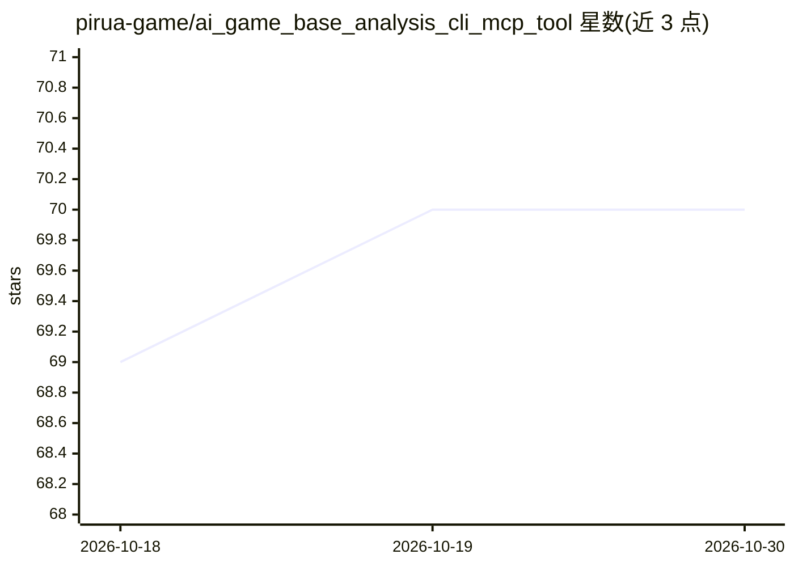

# pirua-game/ai_game_base_analysis_cli_mcp_tool

⭐ 70 · Python · Apache-2.0 · 推送 2026-04-12 · [GitHub](https://github.com/pirua-game/ai_game_base_analysis_cli_mcp_tool) · 组织维护

**Unity/UE5/Axmol 游戏代码库分析 CLI 与 MCP 工具，供 AI 读取真实代码**

面向游戏开发者的代码库分析工具 gdep：扫描 Unity/UE5/Axmol 项目的依赖耦合、循环依赖、死代码，追踪 C++→Blueprint 调用链，做变更影响分析与重构风险检查；内置 19 条游戏引擎反模式 lint 规则。提供 30 个 MCP 工具，使 Claude Desktop、Cursor 等 agent 基于源码结构事实回答问题，并生成 .gdep/AGENTS.md 告知 agent 何时信任结果；分析结果缓存至 SQLite+FTS5 wiki。附带浏览器 Web UI（依赖图可视化、AI chat agent），本地 LLM 支持 Ollama，Web UI 声明仅限非商业使用且功能可能不完善。需 Python 3.11+，Unity/C# 分析需 .NET Runtime 8.0+。

## 筛选速览

| 维度 | 判定 | 备注 |
|---|---|---|
| AI 角色 | `ai-ecosystem` | LLM/agent 周边工具 |
| 许可风险 | `permissive` | Apache-2.0 |
| 部署形态 | `library` | 以包/库形式分发 |
| 模型依赖 | local-ok | 支持本地模型 |
| 硬件要求 | — | 无带数字的原话,不猜 |
| 安装摩擦 | `medium` | 含编译或系统依赖之一 |
| 成熟度 | `idea` | |

## 能力要点

- 30 个 MCP 工具覆盖依赖分析、影响追踪、GAS/Blueprint/Animator 解析
- 分析结果缓存到 SQLite+FTS5 wiki，含过期检测
- 19 条 Unity/UE5/Axmol 引擎反模式 lint 规则
- UE5 分析结果附带 HIGH/MEDIUM/LOW 置信度头

## 适用场景

- 修改类/方法前检查变更影响与需运行的测试范围
- 让 Claude/Cursor 等 AI 助手基于真实代码结构回答项目问题
- 重构前排查循环依赖、耦合热点与死代码
- 扫描 UE5 GAS Ability 与 Blueprint 映射结构

## 场景标签

 · 领域:游戏开发/代码分析工具

## 证据(README 行号)

> L39: gdep ships an MCP server for Claude Desktop, Cursor, and any MCP-compatible agent.
> L166: After `gdep init`, Claude / Cursor / Gemini automatically read the project context and
> L3: **Understand a Unity/UE5/Axmol project in 0.5 seconds. Make Claude and Cursor read the actual code.**

## 星数曲线

2026-10-18 69 → 2026-10-30 70（+1）

---
*卡片 v1 · prompt 1.4 · 生成 2026-10-24 · 置信度 high · 依据 README sha `6857c80527f3` · [字段定义](../../DATASET.md)*
