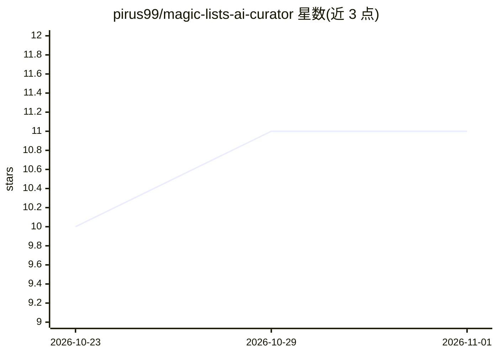

# pirus99/magic-lists-ai-curator

⭐ 11 · Python · 推送 2026-10-05 · [GitHub](https://github.com/pirus99/magic-lists-ai-curator) · 个人维护

**为 Navidrome/Jellyfin 自建音乐库生成 AI 智能歌单的 Web 应用**

面向自托管 Navidrome 或 Jellyfin 音乐服务器的歌单生成器：提供 This Is (Artist)、Artist Radio、Genre Mix、Re-Discover 等 AI 辅助歌单类型，支持每日/每周/每月自动刷新与多库配置。AI 后端可选 Google AI Studio、OpenRouter、Groq 或本地 Ollama。以 Docker Compose（推荐）或 docker run 部署，启动后经 4545 端口访问，自带 /system-check 配置校验页与 FastAPI REST API。本 fork 自 magic-lists-for-navidrome，Jellyfin 客户端等部分功能 README 自述测试不足。

## 筛选速览

| 维度 | 判定 | 备注 |
|---|---|---|
| AI 角色 | `ai-native` | 本体是模型或模型工具 |
| 许可风险 | `none` | — |
| 部署形态 | `self-host` | docker 或自建部署 |
| 模型依赖 | local-ok | 支持本地模型 |
| 硬件要求 | — | 无带数字的原话,不猜 |
| 安装摩擦 | `low` | 无编译、无系统依赖或容器化 |
| 成熟度 | `idea` | |

## 能力要点

- 四类 AI 歌单：This Is (Artist)/Artist Radio/Genre Mix/Re-Discover
- 歌单按日/周/月自动刷新保持更新
- AI 后端支持 Google/OpenRouter/Groq 或本地 Ollama
- 启动时配置校验页与 FastAPI REST API（Swagger/Redoc 文档）

## 适用场景

- 给自建 Navidrome/Jellyfin 音乐库生成艺人精选与流派混合歌单
- 定期轮换久未播放的曲目重新发现收藏
- 完全本地化运行 AI 歌单生成（Ollama）

## 场景标签

 · 领域:自托管媒体/音乐工具

## 证据(README 行号)

> L3: **AI-assisted playlists for your own music library.**
> L5: MagicLists adds the kind of curated, evolving playlists you’d expect from Spotify or Apple Music—except it works ent
> L10: - 🎸 **Genre Mix** — Creates curated playlists from your complete genre collections, using AI to craft the perfect m

## 星数曲线

2026-10-23 10 → 2026-11-01 11（+1）

---
*卡片 v1 · prompt 1.4 · 生成 2026-11-01 · 置信度 high · 依据 README sha `1779ab3226cd` · [字段定义](../../DATASET.md)*
