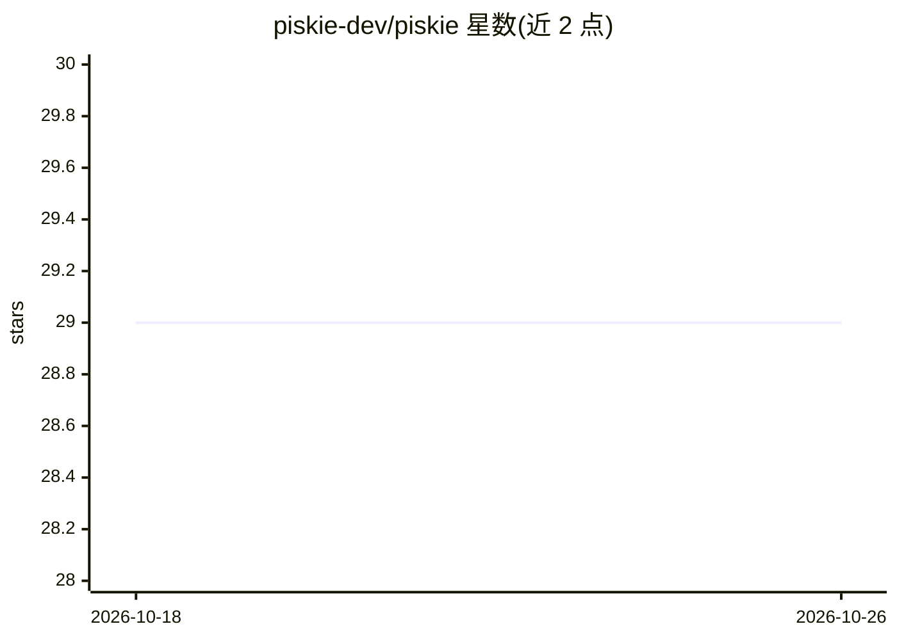

# piskie-dev/piskie

⭐ 29 · TypeScript · MIT · 推送 2026-10-13 · [GitHub](https://github.com/piskie-dev/piskie) · [官网](https://www.piskie.dev/) · 组织维护 · 中文 README

**带指纹浏览器与持久会话的桌面 AI agent，自动化真实网页操作**

桌面端 AI agent 应用：将本地工作区操作与真实网页自动化结合。核心机制包括内置指纹浏览器环境（跨重启保留 cookies、canvas/WebGL 指纹与登录态，实现多账号零重复登录）、将高频网页流程固化为可复用 Browser Skill（自主探索页面后本地生成并校验工具代码）、本地执行循环（检查代码库、改文件、跑测试、子 agent 委派），以及飞书/企业微信/QQ/微信 IM 触发任务。支持 OpenAI 或 Claude 兼容凭据、MCP 协议与本地 ComfyUI 工作流接入。数据存于本地 ~/.piskie。限制：不支持 Intel 版 macOS；计划任务需应用运行中执行。

## 筛选速览

| 维度 | 判定 | 备注 |
|---|---|---|
| AI 角色 | `ai-native` | 本体是模型或模型工具 |
| 许可风险 | `permissive` | MIT |
| 部署形态 | `desktop` | 安装包/桌面程序 |
| 模型依赖 | — | README 未给出锁定关系 |
| 硬件要求 | — | 无带数字的原话,不猜 |
| 安装摩擦 | `low` | 无编译、无系统依赖或容器化 |
| 成熟度 | `idea` | |

## 能力要点

- 指纹浏览器环境持久保存会话与账号指纹，多账号免重复登录
- 自主探索网页并将流程合成为可复用、本地校验的 Browser Skill
- 原生 IM 机器人集成（飞书/企微/QQ Bot/个人微信）远程触发任务
- 兼容 MCP 协议、本地 Skills 与插件，支持本地 ComfyUI 工作流

## 适用场景

- 多账号登录后台提取数据并整理为本地 CSV 报表
- 把重复的网页操作流程固化为毫秒级可调用的技能
- 在微信/飞书聊天中直接发起和接收 agent 任务
- 让 agent 在本地代码库中检查、修补文件并跑测试

## 场景标签

`浏览器自动化` `编码 Agent` · 领域:效率与自动化

## 证据(README 行号)

> L5:  The Desktop AI Agent with Fingerprint Browsers & Persistent Sessions.
> L56: * **Full Local Execution Loop**: Outline goals in plain language. The agent inspects codebases, patches files, runs

## 星数曲线

2026-10-18 29 → 2026-10-26 29（+0）

---
*卡片 v1 · prompt 1.4 · 生成 2026-10-26 · 置信度 high · 依据 README sha `f4579e3b94ca` · [字段定义](../../DATASET.md)*
