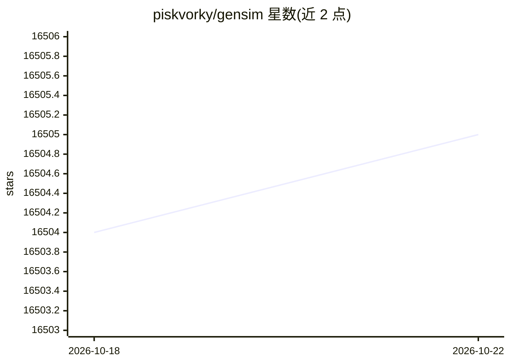

# piskvorky/gensim

⭐ 16,505 · Python · LGPL-2.1 · 推送 2025-11-01 · [GitHub](https://github.com/piskvorky/gensim) · [官网](https://radimrehurek.com/gensim) · 个人维护

**面向 NLP/IR 社区的 Python 主题建模与相似度检索库**

Gensim 是处理大规模语料的 Python 库，提供主题建模、文档索引与相似度检索。算法对语料规模内存无关，可流式处理超出 RAM 的输入；提供 LSA、LDA、RP、HDP、word2vec 等算法的多核实现，并支持在集群上分布式运行 LSA/LDA。通过依赖 NumPy 调用底层 BLAS 库（如 MKL、ATLAS、OpenBLAS）获得性能。目前处于稳定维护模式，不接受新特性，仅接受 bug 与文档修复；4.0.0 起不再支持 Python 2.7。

## 筛选速览

| 维度 | 判定 | 备注 |
|---|---|---|
| AI 角色 | `ai-ecosystem` | LLM/agent 周边工具 |
| 许可风险 | `viral` | LGPL-2.1 |
| 部署形态 | `library` | 以包/库形式分发 |
| 模型依赖 | — | README 未给出锁定关系 |
| 硬件要求 | — | 无带数字的原话,不猜 |
| 安装摩擦 | `low` | 无编译、无系统依赖或容器化 |
| 成熟度 | — | 结构信号不足 |

## 动量与使用信号

- 维护:`declining` — 距上次 push 350.9 天,年发版 0,396 位贡献者
- 涨星:近 1 天 **-2**(自 20261016 起算)
- 安装:pypi 包 `gensim` 月下载 2,893,445

## 能力要点

- 内存无关的流式处理，可处理大于 RAM 的语料
- LSA/LDA/RP/HDP/word2vec 等算法的多核实现
- 支持在计算机集群上分布式运行 LSA 与 LDA
- 提供文档与 Jupyter Notebook 教程

## 适用场景

- 对大规模文本语料做主题建模
- 构建文档相似度检索与文档去重
- 训练 word2vec 等词向量用于下游 NLP 任务

## 场景标签

`语义搜索` · 领域:知识与检索

## 证据(README 行号)

> L10: Gensim is a Python library for *topic modelling*, *document indexing*
> L12: *natural language processing* (NLP) and *information retrieval* (IR)
> L17: ## ⚠️ Gensim is in stable maintenance mode: we are not accepting new features, but bug and documentation fixes are 

## 星数曲线

2026-10-18 16,504 → 2026-10-22 16,505（+1）

---
*卡片 v1 · prompt 1.4 · 生成 2026-10-18 · 置信度 high · 依据 README sha `bbdfe0f27f35` · [字段定义](../../DATASET.md)*
