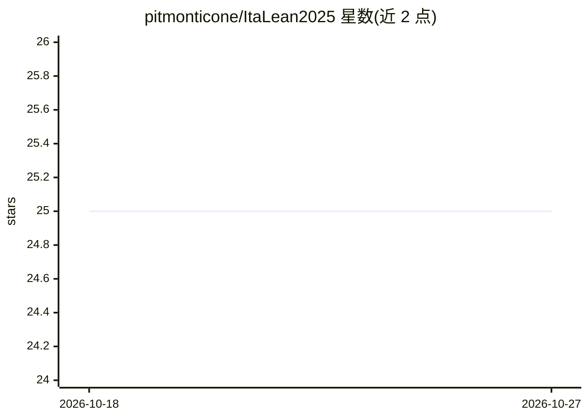

# pitmonticone/ItaLean2025

⭐ 25 · HTML · Apache-2.0 · 推送 2026-07-27 · [GitHub](https://github.com/pitmonticone/ItaLean2025) · [官网](https://pitmonticone.github.io/ItaLean2025/) · 组织维护

**ItaLean 2025 会议资源仓库：Lean 4 项目与学习资源汇总**

托管 2025 年 12 月博洛尼亚 ItaLean 会议资源的仓库：提供 Lean 安装指引、克隆仓库后用 lake exe cache get 拉取缓存依赖并用 lake build 验证构建的步骤；含会议期间发起或推进的项目列表（将随项目进展更新）以及指向官方 Lean 学习页面的教程、书籍、练习与工具等资源链接。由博洛尼亚大学等机构支持，面向形式化数学与 AI4Math 领域的与会者与学习者。

## 筛选速览

| 维度 | 判定 | 备注 |
|---|---|---|
| AI 角色 | `ai-knowledge` | 知识聚合/清单类 |
| 许可风险 | `permissive` | Apache-2.0 |
| 部署形态 | `None` |  |
| 模型依赖 | — | README 未给出锁定关系 |
| 硬件要求 | — | 无带数字的原话,不猜 |
| 安装摩擦 | `low` | 无编译、无系统依赖或容器化 |
| 成熟度 | — | 结构信号不足 |

## 能力要点

- 提供 Lean 安装与 lake 构建的完整步骤指引
- 汇总会议期间发起或推进的项目
- 链接官方 Lean 学习资源（教程/书籍/练习/工具）

## 适用场景

- 参会者按步骤搭建 Lean 4 环境并构建会议项目
- 跟踪 ItaLean 2025 会议期间产出的项目
- 通过资源列表查找 Lean 学习材料

## 场景标签

`精选清单` · 领域:学习与行业

## 证据(README 行号)

> L25: This section will list all the projects started or advanced during the conference. It will be updated as new projec
> L29: For further learning resources, including tutorials, books, exercises, and tools, please see the official Lean lear

## 星数曲线

2026-10-18 25 → 2026-10-27 25（+0）

---
*卡片 v1 · prompt 1.4 · 生成 2026-10-26 · 置信度 mid · 依据 README sha `191414a77761` · [字段定义](../../DATASET.md)*
