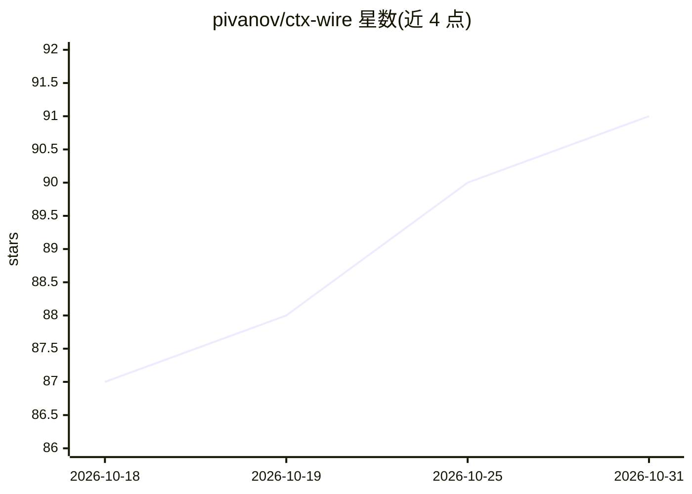

# pivanov/ctx-wire

⭐ 91 · Go · MIT · 推送 2026-10-26 · [GitHub](https://github.com/pivanov/ctx-wire) · [官网](https://www.ctx-wire.dev/) · 组织维护

**压缩 AI 编程 agent 命令输出的 CLI 工具：省 token、防泄密**

位于 AI 编程 agent 与 shell 之间的过滤层：用声明式 TOML 过滤器压缩包安装、测试、lint、搜索等命令的输出，在输出送入模型前擦除敏感信息，完整（已脱敏）日志留盘供失败排查；`ctx-wire init <agent>` 通过 agent hook 或 PATH shim 接入 Claude Code、Cursor、Codex、Copilot 等环境，`ctx-wire gain` 统计节省的字节与 token。另可将 MCP 服务器（如 chrome-devtools、Playwright）经 mcp-wrap 压缩转发。提供 curl/PowerShell 安装脚本，支持 macOS/Linux/Windows。

## 筛选速览

| 维度 | 判定 | 备注 |
|---|---|---|
| AI 角色 | `ai-ecosystem` | LLM/agent 周边工具 |
| 许可风险 | `permissive` | MIT |
| 部署形态 | `None` |  |
| 模型依赖 | — | README 未给出锁定关系 |
| 硬件要求 | — | 无带数字的原话,不猜 |
| 安装摩擦 | `low` | 无编译、无系统依赖或容器化 |
| 成熟度 | — | 结构信号不足 |

## 能力要点

- 声明式 TOML 过滤器压缩命令输出，可拉取/发布社区过滤器
- 模型可见前擦除 secrets，完整脱敏日志留盘
- `ctx-wire gain` 按程序与 agent 统计节省的 token/字节
- MCP 输出压缩（chrome-devtools、Playwright 等经 mcp-wrap 转发）

## 适用场景

- 让 AI 编程 agent 只读到命令输出的关键信息，减少 token 消耗
- 防止命令输出中的密钥等敏感信息进入模型上下文
- 查看各命令与 agent 的 token 节省统计

## 场景标签

 · 领域:开发者工具/AI 编程基础设施

## 证据(README 行号)

> L7: noise you pay tokens for. ctx-wire sits between the agent and the shell: it
> L18: - **Transparent.** One `ctx-wire init <agent>` and commands are filtered through
> L33: - **Works with your stack.** Claude Code, Cursor, Codex, Gemini, GitHub Copilot,

## 星数曲线

2026-10-18 87 → 2026-10-31 91（+4）

---
*卡片 v1 · prompt 1.4 · 生成 2026-10-23 · 置信度 high · 依据 README sha `bcb55d32cc4f` · [字段定义](../../DATASET.md)*
