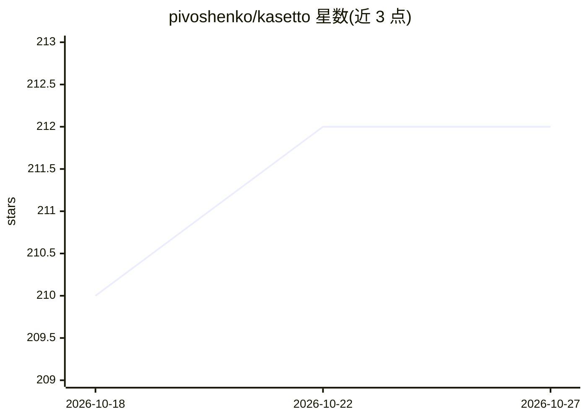

# pivoshenko/kasetto

⭐ 212 · Rust · NOASSERTION · 推送 2026-10-22 · [GitHub](https://github.com/pivoshenko/kasetto) · [官网](https://kasetto.dev) · 个人维护

**声明式 AI agent 环境管理器：一个 YAML 同步 skills/MCP/命令到多个 agent**

用 Rust 编写的 CLI 工具，以单个 kasetto.yaml 声明式管理 AI agent 的 skills、commands、MCP 与 instructions，并转换为各 agent 原生格式安装到对应目录。支持 24 种 agent（Claude Code、Cursor、Codex、Copilot 等）、GitHub/GitLab/Bitbucket 等私有仓库拉取、cargo/uv 式 lock 文件锁定版本、通过占位符对接 1Password/Vault/AWS 等密钥管理器。分发为 macOS/Linux/Windows 单一静态二进制，提供 curl 安装器、Homebrew、Scoop 与 cargo 安装方式。

## 筛选速览

| 维度 | 判定 | 备注 |
|---|---|---|
| AI 角色 | `ai-ecosystem` | LLM/agent 周边工具 |
| 许可风险 | `none` | NOASSERTION |
| 部署形态 | `library` | 以包/库形式分发 |
| 模型依赖 | — | README 未给出锁定关系 |
| 硬件要求 | — | 无带数字的原话,不猜 |
| 安装摩擦 | `low` | 无编译、无系统依赖或容器化 |
| 成熟度 | — | 结构信号不足 |

## 能力要点

- 单 YAML 管理 skills/commands/MCPs/instructions 并同步到 24 种 agent
- lock 文件锁定版本，CI 支持 --json 输出与 --locked 模式
- 私有仓库（GitHub/GitLab/Bitbucket/Gitea 等）env-var token 认证
- 密钥占位符注入 1Password/Vault/AWS/GCP/Azure 等 10 种来源

## 适用场景

- 团队用一份配置文件统一所有成员的 AI agent 技能环境
- 跨多台机器、多个 agent 同步同一套 skills 与 MCP 配置
- 在 CI 中以 lock 模式保证 agent 环境版本一致

## 场景标签

 · 领域:开发者工具/AI agent 基础设施

## 证据(README 行号)

> L25: Kasetto is a **community-first** project that solves a different problem: **declarative, reproducible AI environmen
> L30: - **Skills, Commands, MCPs & Instructions**: four asset kinds from one source, instruction files included (`CLAUDE.
> L132: |`kst sync`|Install skills, MCPs, commands, and instructions into agent dirs, honoring the lock|

## 星数曲线

2026-10-18 210 → 2026-10-27 212（+2）

---
*卡片 v1 · prompt 1.4 · 生成 2026-10-22 · 置信度 high · 依据 README sha `b3dcaee9e0f5` · [字段定义](../../DATASET.md)*
