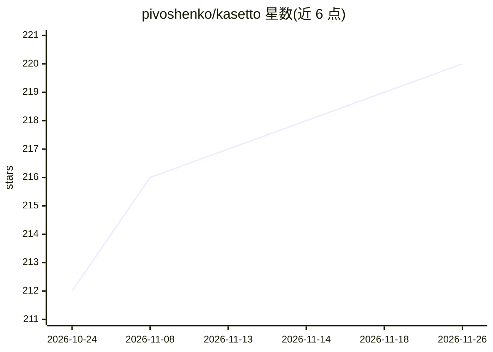

# pivoshenko/kasetto

⭐ 220 · Rust · NOASSERTION · 推送 2026-11-20 · [GitHub](https://github.com/pivoshenko/kasetto) · [官网](https://kasetto.dev) · 个人维护

**声明式 AI agent 环境管理器：用 YAML 统一管理 skills/MCP/命令**

用 Rust 编写的 CLI 工具，将 skills、commands、subagents、MCP、instructions、plugins 六类资产声明在一份 YAML 配置中，同步到 23 种 agent（Claude Code、Cursor、Codex 等）各自的目录格式。支持 extends 继承组合团队配置、GitHub/GitLab 等私有仓库拉取、${kst_...} 占位符从 1Password/Vault 等密钥管理器注入令牌、lock 文件版本锁定与内容哈希增量同步，并提供 kst audit 安全审计（skills.sh/OSV/deps.dev）。单一静态二进制，支持 CI 的 --json 输出。

## 筛选速览

| 维度 | 判定 | 备注 |
|---|---|---|
| AI 角色 | `ai-ecosystem` | LLM/agent 周边工具 |
| 许可风险 | `none` | NOASSERTION |
| 部署形态 | `library` | 以包/库形式分发 |
| 模型依赖 | — | README 未给出锁定关系 |
| 硬件要求 | — | 无带数字的原话,不猜 |
| 安装摩擦 | `low` | 无编译、无系统依赖或容器化 |
| 成熟度 | — | 结构信号不足 |

## 能力要点

- 一份 YAML 声明六类 agent 资产，同步为各 agent 原生格式并自动合并
- lock 文件与内容哈希实现可复现、增量同步；--locked 供 CI 强制校验
- 占位符密钥注入：环境变量/credentials 文件/1Password/Vault/AWS/GCP/Azure 等 10 类来源
- kst audit 对已装 skills 与 MCPs 输出安全判定

## 适用场景

- 团队用一份共享配置让所有成员的 agent 环境保持一致
- 在多个 AI 编辑器/CLI 之间迁移 skills 与 MCP 配置而无需重建
- 企业从私有 Git 仓库分发内部指令、工具与提示词资产

## 场景标签

 · 领域:AI agent 基础设施/开发者工具

## 证据(README 行号)

> L25: Kasetto is a **community-first** project that solves a different problem: **declarative, reproducible AI environmen
> L29: - **Agent-agnostic**: use Claude Code, Cursor, Codex, Windsurf, Copilot, Gemini CLI, or any supported agent, and sw
> L133: |`kst sync`|Install skills, MCPs, commands, subagents, and instructions, enable plugins, honoring the lock|

## 星数曲线

2026-10-24 212 → 2026-11-26 220（+8）

---
*卡片 v1 · prompt 1.4 · 生成 2026-11-25 · 置信度 high · 依据 README sha `72790823fd25` · [字段定义](../../DATASET.md)*
