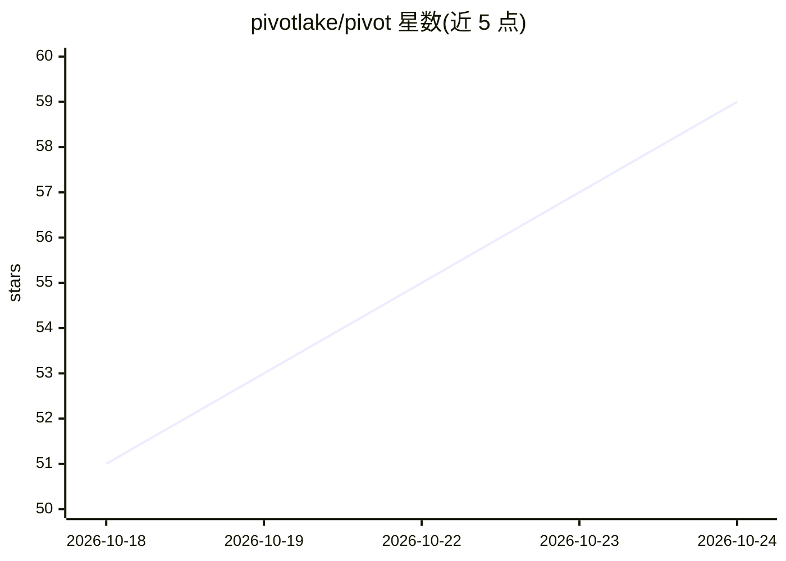

# pivotlake/pivot

⭐ 59 · Rust · Apache-2.0 · 推送 2026-10-20 · [GitHub](https://github.com/pivotlake/pivot) · [官网](https://pivotlake.io) · 组织维护

**基于开放数据格式的高性能分析型数据库**

用 Rust 编写的分析型数据库引擎，直接运行在 Delta Lake 与 Iceberg 等开放表格式之上，以对象存储为后端存储，提供低延迟查询与高并发，无需将数据复制到专用实时分析库。支持以服务器形式或本地引擎方式运行，可被后端、用户与 agent 直接查询数据源；可随负载扩缩容至零。项目声明处于早期开发阶段，尚不面向生产环境，版本间可能出现破坏性变更。

## 筛选速览

| 维度 | 判定 | 备注 |
|---|---|---|
| AI 角色 | `ai-enhanced` | 去掉 AI 部分产品仍成立 |
| 许可风险 | `permissive` | Apache-2.0 |
| 部署形态 | `None` |  |
| 模型依赖 | — | README 未给出锁定关系 |
| 硬件要求 | — | 无带数字的原话,不猜 |
| 安装摩擦 | `low` | 无编译、无系统依赖或容器化 |
| 成熟度 | `idea` | |

## 能力要点

- 直接查询 Delta Lake 与 Iceberg 开放表格式，无需数据复制
- 对象存储作为后端，可扩容、缩容、缩至零
- 既可作服务器运行，也可作本地引擎供用户与 agent 直接查询

## 适用场景

- 在数据湖上直接跑低延迟分析查询，省去另建实时分析库
- 本地临时查询与 agent 分析复用同一引擎与架构
- 仪表盘与应用内分析共享同一数据源

## 场景标签

 · 领域:数据库/大数据分析

## 证据(README 行号)

> L12: Pivot is a high-performance analytics database that runs on open data formats. It delivers low-latency queries and 
> L24: - **Portable** - Pivot can run both as a server serving backends and clients, or as a local engine where users and 

## 星数曲线

2026-10-18 51 → 2026-10-24 59（+8）

---
*卡片 v1 · prompt 1.4 · 生成 2026-10-24 · 置信度 mid · 依据 README sha `1353b6de3ee8` · [字段定义](../../DATASET.md)*
