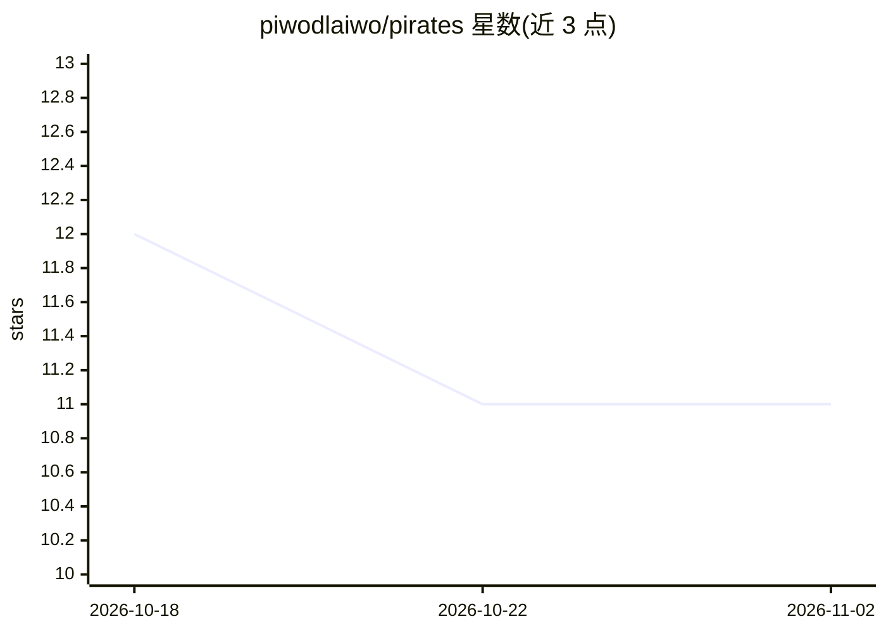

# piwodlaiwo/pirates

⭐ 11 · TypeScript · 推送 2026-06-15 · [GitHub](https://github.com/piwodlaiwo/pirates) · [官网](https://piwodlaiwo.github.io/pirates/) · 个人维护

**浏览器端俯视角海战游戏：风帆机动与侧舷炮对战**

用 HTML5 Canvas 2D 与 TypeScript 编写、无游戏框架、纯前端运行的俯视角海战游戏，灵感来自《Sid Meier's Pirates!》的海战。提供三种船型与三档难度，玩家操舵、侧舷齐射，敌方船长有追逐、抢占射击位、预判射击等行为；风向影响航速，弹丸逐颗追踪命中。开发用 Vite，构建产物为静态文件，推送到 main 时经 GitHub Actions 自动发布到 GitHub Pages。README 未涉及任何 AI 模型或 AI 功能。

## 筛选速览

| 维度 | 判定 | 备注 |
|---|---|---|
| AI 角色 | `ai-enhanced` | 去掉 AI 部分产品仍成立 |
| 许可风险 | `none` | — |
| 部署形态 | `library` | 以包/库形式分发 |
| 模型依赖 | — | README 未给出锁定关系 |
| 硬件要求 | — | 无带数字的原话,不猜 |
| 安装摩擦 | `low` | 无编译、无系统依赖或容器化 |
| 成熟度 | — | 结构信号不足 |

## 能力要点

- 纯前端 HTML5 Canvas + TypeScript 实现，无框架无后端
- 三种船型与三档难度，难度改变敌方船长行为而非伤害数值
- 风向影响航速（横风全速、逆风 40%），弹丸逐颗追踪命中
- 推送到 main 自动构建并发布到 GitHub Pages

## 适用场景

- 在浏览器中直接进行单场海战对局
- 作为 Canvas 游戏开发的参考项目（单表调平衡、静态托管）
- Fork 后自行改船型数值或部署到 GitHub Pages

## 场景标签

 · 领域:游戏

## 证据(README 行号)

> L23: captain does the same: it chases you from a distance, then turns sideways to
> L49: Difficulty changes the enemy captain's skill, never the damage numbers — every

## 星数曲线

2026-10-18 12 → 2026-11-02 11（-1）

---
*卡片 v1 · prompt 1.4 · 生成 2026-11-01 · 置信度 low · 依据 README sha `b59b94b287fd` · [字段定义](../../DATASET.md)*
