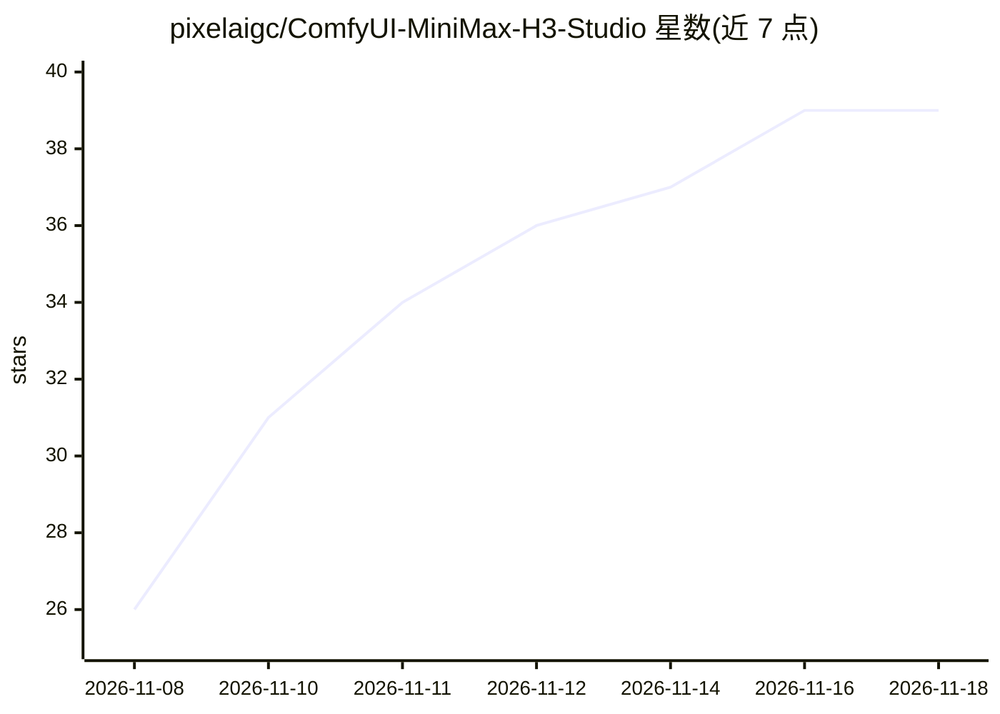

# pixelaigc/ComfyUI-MiniMax-H3-Studio

⭐ 39 · Python · MIT · 推送 2026-11-07 · [GitHub](https://github.com/pixelaigc/ComfyUI-MiniMax-H3-Studio) · 组织维护 · 中文 README

**面向新手的 MiniMax H3 本地视频生成 Web 工作台（免节点图）**

基于本机 ComfyUI 的 Windows 本地 Web 工作台，把 MiniMax H3 视频生成（文生视频/首尾帧/参考生成）、Z-IMAGE 与 Qwen Image 2.1 文生图、Windows SAPI 离线中文 TTS、ffmpeg 长片拼接与任务队列卡片流整合进无节点图界面。它自身不是生成引擎，需预先安装 ComfyUI 及对应模型权重，复用 ComfyUI 自带 Python，双击 启动.bat 运行，浏览器访问 8190 端口；提供 HTTP API 供 AI 智能体批量调用生成长片。

## 筛选速览

| 维度 | 判定 | 备注 |
|---|---|---|
| AI 角色 | `ai-native` | 本体是模型或模型工具 |
| 许可风险 | `permissive` | MIT |
| 部署形态 | `None` |  |
| 模型依赖 | — | README 未给出锁定关系 |
| 硬件要求 | — | 无带数字的原话,不猜 |
| 安装摩擦 | `medium` | 含编译或系统依赖之一 |
| 成熟度 | — | 结构信号不足 |

## 能力要点

- 文生视频/首尾帧/参考生成/PIKA H3 Flex 多模式，Turbo LoRA 默认 6 步加速
- 任务卡片流资产管理：搜索、筛选、复用参数，数据存于本地 SQLite
- Z-IMAGE / Qwen Image 2.1 文生图与 Windows SAPI 离线中文 TTS
- HTTP API 供 AI 智能体一句话生成分段拼接的长片

## 适用场景

- 不学 ComfyUI 节点图，本地用 MiniMax H3 生成视频和图片
- 用任务卡片统一管理、检索和复用生成资产
- 让本机 AI 智能体通过 API 批量分段生成长视频并自动拼接

## 场景标签

`视频生成` `图像生成` `语音合成` · 领域:内容生成

## 证据(README 行号)

> L7: 本地 Web 工作台，驱动本机 ComfyUI 生成视频与图片，并提供 Windows 本机离线 TTS。左侧选模式 → 中间调参数 → 右侧看任务卡片流，队列自动 FIFO 执行。直接复用 ComfyUI 自带的 Python 运
> L21: - **文生视频 / 首尾帧 / 参考生成** — MiniMax H3，Turbo LoRA 加速（默认 6 步）或标准 H3（20 步）
> L60: H3 Studio 不是独立的生成引擎，它驱动本机已经装好的 ComfyUI 出片。开始前备齐下面几样：

## 星数曲线

2026-11-08 26 → 2026-11-18 39（+13）

---
*卡片 v1 · prompt 1.4 · 生成 2026-11-18 · 置信度 high · 依据 README sha `c478e6f7232d` · [字段定义](../../DATASET.md)*
