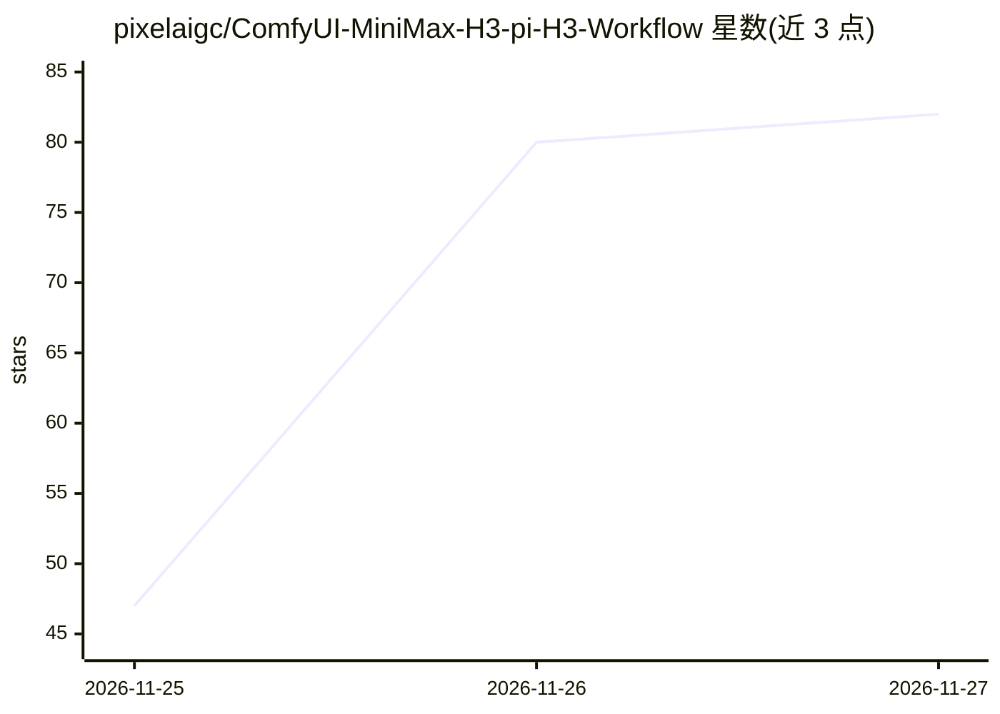

# pixelaigc/ComfyUI-MiniMax-H3-pi-H3-Workflow

⭐ 82 · 推送 2026-11-23 · [GitHub](https://github.com/pixelaigc/ComfyUI-MiniMax-H3-pi-H3-Workflow) · [官网](https://pixelaigc.cc) · 个人维护 · 中文 README

**ComfyUI 首尾帧音视频生成工作流，面向 RTX 3060 用户**

为 ComfyUI 提供的 MiniMax H3 FL2VA 工作流：根据提示词与首帧/尾帧生成带同步音频的视频，通过 pi-H3 Adapter 将采样压缩到 2 步或 4 步，并使用 Sol Block Sparse Attention 加速采样、DWD Decode 降低长视频解码压力。以 JSON 工作流文件形式分发，需自行安装 ComfyUI-piFlow 节点并下载模型文件；README 含 Windows 与 RTX 3060 12GB 的实测耗时数据。模型文件不包含在仓库中，需遵守各上游许可。

## 筛选速览

| 维度 | 判定 | 备注 |
|---|---|---|
| AI 角色 | `ai-native` | 本体是模型或模型工具 |
| 许可风险 | `none` | — |
| 部署形态 | `None` |  |
| 模型依赖 | — | README 未给出锁定关系 |
| 硬件要求 | — | 无带数字的原话,不猜 |
| 安装摩擦 | `medium` | 含编译或系统依赖之一 |
| 成熟度 | — | 结构信号不足 |

## 能力要点

- 首帧、尾帧或首尾帧联合约束的视频生成，音画同步
- pi-H3 2-step/4-step Adapter 可切换（2 步更快、4 步采样更充分）
- Sol 稀疏注意力加速采样 + DWD 解码降低显存压力
- 内置画幅、分辨率、时长与提示词控制

## 适用场景

- 用首尾帧控制生成带对白和环境声的视频
- 在 RTX 3060 12GB 显卡上本地运行视频生成
- 快速测试 2 步加速模式或输出较长时长视频

## 场景标签

`视频生成` · 领域:内容生成

## 证据(README 行号)

> L16: 这是一个面向 **MiniMax H3** 的 ComfyUI **FL2VA（First/Last Frame to Video and Audio）** 工作流。它可以根据提示词与首帧、尾帧生成带同步音频的视频，并通过 pi-
> L144: This repository provides a ComfyUI FL2VA workflow for **MiniMax H3 + pi-H3**. It generates synchronized video and 

## 星数曲线

2026-11-25 47 → 2026-11-27 82（+35）

---
*卡片 v1 · prompt 1.4 · 生成 2026-11-24 · 置信度 high · 依据 README sha `9b81eaba026c` · [字段定义](../../DATASET.md)*
