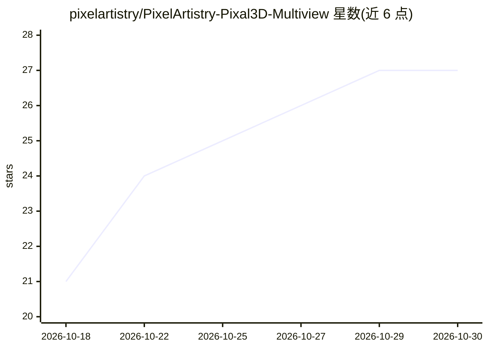

# pixelartistry/PixelArtistry-Pixal3D-Multiview

⭐ 27 · Batchfile · MIT · 推送 2026-09-29 · [GitHub](https://github.com/pixelartistry/PixelArtistry-Pixal3D-Multiview) · 个人维护

**本地 ComfyUI 工作流：一条提示词生成 3D 角色 GLB 模型**

基于 ComfyUI 的免费本地工作流，流程为：Qwen-Image 2.1 从提示词生成 T 姿正面图，Qwen-Image 2.1 Edit 扩展为 4096×1024 的四视角转面图，切分并去背居中为四张 1024×1024 视图，再交给 Pixal3D Multiview 生成带贴图的 3D 网格并导出 GLB。面向会在 ComfyUI 中跑工作流的创作者，无需自定义节点。要求约 25GB 磁盘放模型、约 12GB VRAM，模型下载脚本仅支持 Windows，其他系统需手动下载。

## 筛选速览

| 维度 | 判定 | 备注 |
|---|---|---|
| AI 角色 | `ai-native` | 本体是模型或模型工具 |
| 许可风险 | `permissive` | MIT |
| 部署形态 | `None` |  |
| 模型依赖 | — | README 未给出锁定关系 |
| 硬件要求 | — | 无带数字的原话,不猜 |
| 安装摩擦 | `low` | 无编译、无系统依赖或容器化 |
| 成熟度 | — | 结构信号不足 |

## 能力要点

- 单提示词到四视角角色图到 GLB 3D 网格的完整管线
- 使用 Qwen-Image 2.1 与 Pixal3D Multiview 等 ComfyUI 核心节点，无需自定义节点
- 提供 Windows 模型下载脚本与带表格的手动下载指引
- 文档包含提示词公式、裁切参数表与故障排查（如四视角不纯导致的网格扭曲）

## 适用场景

- 为角色或道具设计生成多视角设定图
- 从一段文字描述得到可导出的 GLB 带贴图 3D 模型
- 本地离线运行图像生成与图生 3D 流程，不依赖付费 API

## 场景标签

`图像生成` · 领域:内容生成

## 证据(README 行号)

> L3: Free & local ComfyUI workflow that turns one prompt into a **4-view character sheet** (front / left / back / right) 
> L17: 1. **Front view.** Qwen-Image 2.1 turns your prompt into one T-posed front view on a white background.
> L20: 4. **Pixal3D Multiview.** The four views go into Pixal3D as front / left / back / right (fixed 90° steps). It build

## 星数曲线

2026-10-18 21 → 2026-10-30 27（+6）

---
*卡片 v1 · prompt 1.4 · 生成 2026-10-26 · 置信度 high · 依据 README sha `f6b204d3e9e3` · [字段定义](../../DATASET.md)*
