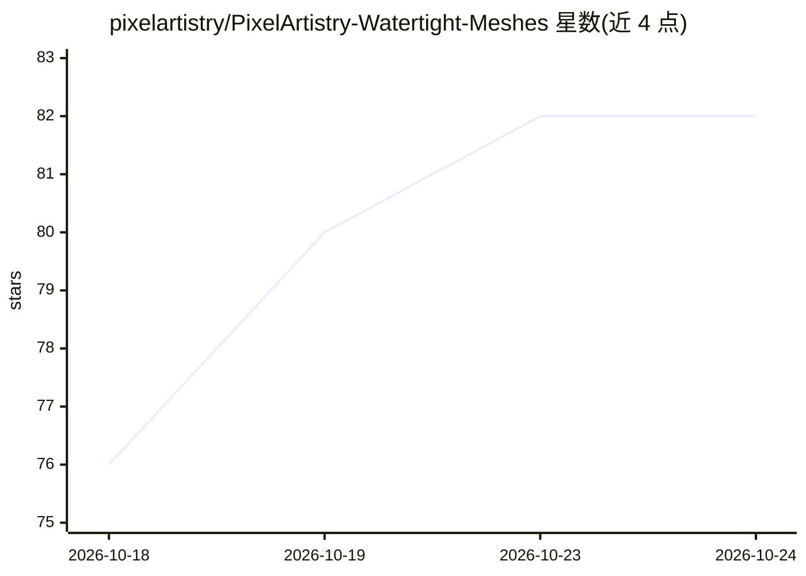

# pixelartistry/PixelArtistry-Watertight-Meshes

⭐ 82 · Batchfile · NOASSERTION · 推送 2026-09-30 · [GitHub](https://github.com/pixelartistry/PixelArtistry-Watertight-Meshes) · 组织维护

**单图生成水密 3D 模型与游戏低模的 ComfyUI 工作流集**

面向 ComfyUI 用户的图生 3D 资产工作流包：基于 Pixal3D / TRELLIS.2，将单张图片转换为水密 3D 模型（可打印）或带烘焙贴图的游戏低模，也可处理用户自有网格。提供 Windows 一键安装器，自动检查 GPU/模型/Blender、下载节点包并安装四个工作流。限制：需预先配置 ComfyUI + TRELLIS.2 环境，仅支持 Windows 10/11 与 NVIDIA RTX 20 系以上，建议 32 GB 内存，水密与烘焙步骤依赖 MostAadTech 的开源节点。

## 筛选速览

| 维度 | 判定 | 备注 |
|---|---|---|
| AI 角色 | `ai-native` | 本体是模型或模型工具 |
| 许可风险 | `none` | NOASSERTION |
| 部署形态 | `desktop` | 安装包/桌面程序 |
| 模型依赖 | — | README 未给出锁定关系 |
| 硬件要求 | — | 无带数字的原话,不猜 |
| 安装摩擦 | `medium` | 含编译或系统依赖之一 |
| 成熟度 | — | 结构信号不足 |

## 能力要点

- 单图 → 水密 3D 模型（1536/2048 两档分辨率，2K 需 16 GB+ VRAM）
- 单图/自有网格 → 带烘焙贴图的游戏低模
- Windows 一键 .bat 安装器：检查 GPU/CUDA/模型并自动下载节点包
- 按 VRAM 档位（6/8/16 GB+）给出分辨率与代理点数设置

## 适用场景

- 把一张图片变成可 3D 打印的水密模型
- 为游戏生成带烘焙贴图的低模资产
- 在 ComfyUI 里把自有网格加工为贴图低模

## 场景标签

 · 领域:3D 生成/游戏资产

## 证据(README 行号)

> L3: Free & local ComfyUI workflows that turn a single image into a **watertight 3D model** – and into a **game-ready low
> L15: |`workflows/PixelArtistry_01_Image_to_Watertight_Mesh.json`|Image → watertight 3D model (1536) – also print-ready|
> L24: - **A working ComfyUI + TRELLIS.2 setup – follow the TRELLIS.2 Installation Guide**

## 星数曲线

2026-10-18 76 → 2026-10-24 82（+6）

---
*卡片 v1 · prompt 1.4 · 生成 2026-10-24 · 置信度 high · 依据 README sha `5a978085c68e` · [字段定义](../../DATASET.md)*
