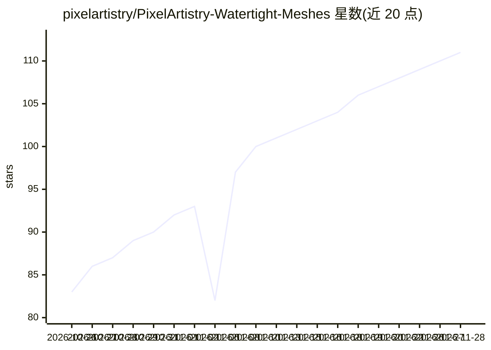

# pixelartistry/PixelArtistry-Watertight-Meshes

⭐ 111 · Batchfile · NOASSERTION · 推送 2026-11-27 · [GitHub](https://github.com/pixelartistry/PixelArtistry-Watertight-Meshes) · 个人维护

**ComfyUI 工作流集：单图生成水密 3D 模型与游戏低模**

提供四个本地运行的 ComfyUI 工作流和一个 Windows 一键 .bat 安装器：把单张图像转为水密 3D 模型（可打印）或带烘焙贴图的游戏就绪低多边形资产，也支持用户自有网格。安装器负责检查 Python/PyTorch/CUDA/GPU/Blender、按 GPU 选择 WTiVo 构建、安装节点包并从 Hugging Face 下载缺失模型。前置条件是需先完成 ComfyUI + TRELLIS.2 安装，且仅面向 Windows 与 NVIDIA RTX 显卡用户。核心节点由 MostAadTech 提供。

## 筛选速览

| 维度 | 判定 | 备注 |
|---|---|---|
| AI 角色 | `ai-native` | 本体是模型或模型工具 |
| 许可风险 | `none` | NOASSERTION |
| 部署形态 | `desktop` | 安装包/桌面程序 |
| 模型依赖 | — | README 未给出锁定关系 |
| 硬件要求 | `gpu-24g` | |
| 安装摩擦 | `medium` | 含编译或系统依赖之一 |
| 成熟度 | — | 结构信号不足 |

## 能力要点

- 四个工作流覆盖图像→水密网格（1536/2048）→游戏就绪低模及自有网格处理
- 一键安装器检查环境、按 RTX 50/20-40 选择 WTiVo 构建、可重复运行回退到测试版本
- 按 VRAM 给出分辨率与代理点数设置表（6/8/16 GB+）
- 工作流基于 ComfyUI 官方 Pixal3D / TRELLIS.2 模板，MIT 许可

## 适用场景

- 从单张图片生成可 3D 打印的水密模型
- 为游戏制作带烘焙贴图的低多边形资产
- 把自己已有的网格转成游戏就绪低模

## 场景标签

 · 领域:3D 内容生成/游戏资产

## 证据(README 行号)

> L3: Free & local ComfyUI workflows that turn a single image into a **watertight 3D model** – and into a **game-ready low
> L25: - Windows 10 or 11, NVIDIA RTX 20 series or newer
> L26: - ComfyUI Easy-Install with Python 3.12 and PyTorch 2.8.0 + CUDA 12.8

## 星数曲线

2026-10-26 83 → 2026-11-28 111（+28）

---
*卡片 v1 · prompt 1.4 · 生成 2026-11-28 · 置信度 high · 依据 README sha `857227a02839` · [字段定义](../../DATASET.md)*
