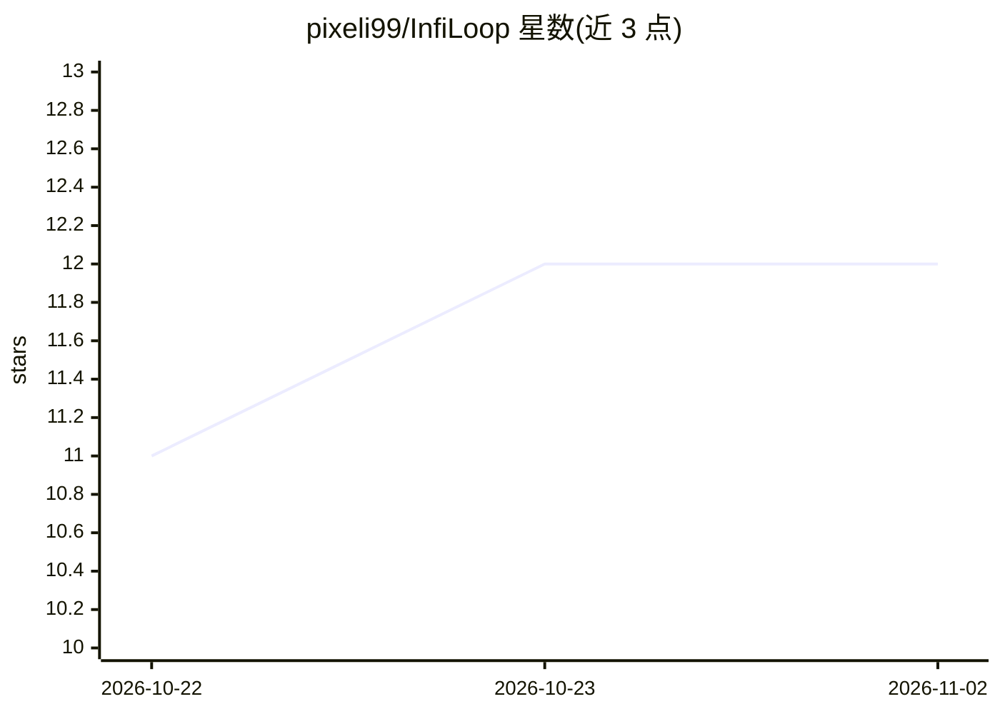

# pixeli99/InfiLoop

⭐ 12 · Python · MIT · 推送 2026-10-21 · [GitHub](https://github.com/pixeli99/InfiLoop) · [官网](https://arxiv.org/abs/2610.11570) · 组织维护

**循环 Transformer 的循环原生残差连接方法（研究代码）**

论文配套代码：提出 InfiLoop，一种面向循环 Transformer 的循环原生残差连接，以内容加权与可学习时间衰减维持循环状态的运行摘要，持久记忆为每 token 一个 d 维向量加一个标量，与循环次数无关。7M 参数模型在 Sudoku-Extreme 达 97.9% 精确准确率、ARC-AGI-2 pass@2 13.6%，测试时循环超过 20,000 有效步仍持续提升。仓库 sudoku/ 目录含数据准备、训练与跨深度评估，Maze-Hard 与 ARC-AGI 代码标注后续发布；Sudoku 检查点托管于 Hugging Face。MIT 许可。

## 筛选速览

| 维度 | 判定 | 备注 |
|---|---|---|
| AI 角色 | `ai-native` | 本体是模型或模型工具 |
| 许可风险 | `permissive` | MIT |
| 部署形态 | `None` |  |
| 模型依赖 | — | README 未给出锁定关系 |
| 硬件要求 | — | 无带数字的原话,不猜 |
| 安装摩擦 | `low` | 无编译、无系统依赖或容器化 |
| 成熟度 | — | 结构信号不足 |

## 能力要点

- 内容加权+学习时间衰减的流式循环残差，记忆占用与循环次数无关
- 7M 参数：Sudoku-Extreme 97.9%，ARC-AGI-2 pass@2 13.6%
- Sudoku-Extreme 上测试时循环超 20,000 有效步仍持续提升
- 提供 sudoku/ 训练与评估代码及 Hugging Face 检查点

## 适用场景

- 复现论文的 Sudoku-Extreme 训练与跨深度评估
- 研究循环 Transformer 的测试时深度扩展
- 对比递归推理架构的基准结果

## 场景标签

`模型训练` · 领域:训练与推理

## 证据(README 行号)

> L18: **InfiLoop** is a loop-native residual connection for looped Transformers.
> L24: In this paper, we argue that looped Transformers need their own residual connections to prevent performance degrada
> L90: sudoku/ contains data preparation, training, fixed-depth evaluation, and the evaluation across depths behind the 97

## 星数曲线

2026-10-22 11 → 2026-11-02 12（+1）

---
*卡片 v1 · prompt 1.4 · 生成 2026-11-01 · 置信度 high · 依据 README sha `7a362316e3b9` · [字段定义](../../DATASET.md)*
