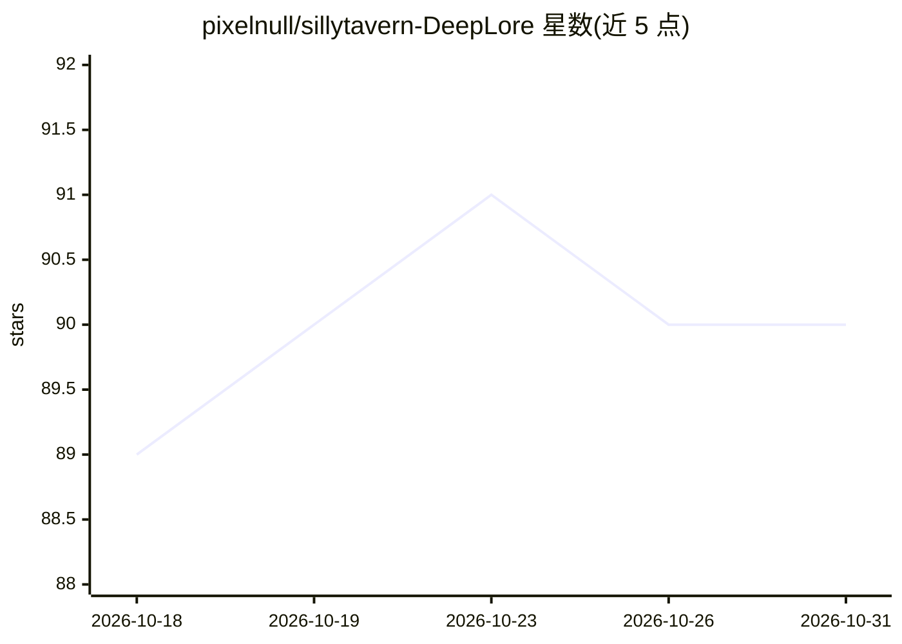

# pixelnull/sillytavern-DeepLore

⭐ 90 · JavaScript · MIT · 推送 2026-07-04 · [GitHub](https://github.com/pixelnull/sillytavern-DeepLore) · [官网](https://pixelnull.github.io/sillytavern-DeepLore/) · 个人维护

**SillyTavern 的 Obsidian 世界书引擎：关键词+AI 检索并自动注入上下文**

SillyTavern 扩展，把世界书（lorebook）存放在 Obsidian vault 中，替代内置 World Info 的纯关键词匹配：两阶段检索（关键词+BM25 → AI 读摘要选条目）、按时代/地点/场景/角色的门控、冷却与预算控制，命中条目自动注入对话上下文。附带图书管理员 agent Emma：写作 AI 发现设定空缺时标记，由 Emma 辅助起草并回写 vault；还有 200+ 节点关系图、会话摘要回写、逐条激活溯源等工具。需 SillyTavern 1.12.14+、Obsidian Local REST API 插件；AI 检索可选，关键词模式免费；Emma 需支持工具调用的 provider。自述仍为 beta，World Info 部分高级行为导入后不生效。

## 筛选速览

| 维度 | 判定 | 备注 |
|---|---|---|
| AI 角色 | `ai-ecosystem` | LLM/agent 周边工具 |
| 许可风险 | `permissive` | MIT |
| 部署形态 | `None` |  |
| 模型依赖 | — | README 未给出锁定关系 |
| 硬件要求 | — | 无带数字的原话,不猜 |
| 安装摩擦 | `low` | 无编译、无系统依赖或容器化 |
| 成熟度 | `idea` | |

## 能力要点

- 两阶段检索：关键词+BM25 模糊匹配，AI 读摘要二次筛选，无需用户输入关键词
- Emma 图书管理员 agent：标记设定空缺、起草 vault 条目并回写 Obsidian
- 200+ 节点力导向关系图与 Louvain 聚类、gap 分析
- AI 检索阶段可接本地运行时（Ooba/KoboldCpp/llama.cpp）

## 适用场景

- 大规模世界书场景下让设定条目在关键词未出现时也能命中
- 用 Obsidian 统一管理角色扮演的世界设定，避免 JSON 与笔记双处漂移
- 角色扮演中由 AI 辅助发现设定空缺并补写条目

## 场景标签

`知识库管理` `RAG` · 领域:知识与检索

## 证据(README 行号)

> L5: **World Info keyword matching breaks at scale. DeepLore reads your Obsidian vault instead: keywords plus AI retrieva
> L31: Chat → matchEntries (keywords + BM25 fuzzy)
> L36:      → inject → generate

## 星数曲线

2026-10-18 89 → 2026-10-31 90（+1）

---
*卡片 v1 · prompt 1.4 · 生成 2026-10-23 · 置信度 high · 依据 README sha `cb5ec125c42f` · [字段定义](../../DATASET.md)*
