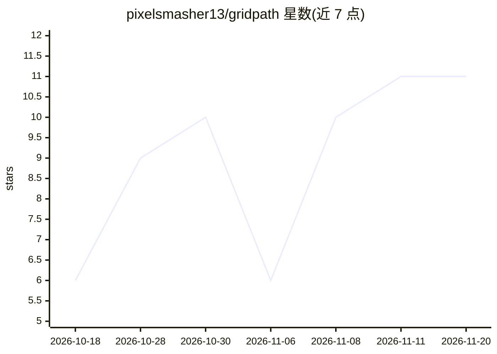

# pixelsmasher13/gridpath

⭐ 11 · TypeScript · Apache-2.0 · 推送 2026-11-17 · [GitHub](https://github.com/pixelsmasher13/gridpath) · [官网](https://gridpath.dev) · 个人维护

**可嵌入网页的电子表格组件与 MCP 服务器，读取保存 .xlsx**

GridPath 提供三部分：可嵌入 Web 应用的 React 电子表格组件（Rust/WASM 公式引擎）、供编码 Agent 调用的 MCP 服务器、带内置 Agent 的 Tauri 桌面编辑器。组件以 npm 包分发，打开用户的 .xlsx 并回存，保存以补丁方式只改写变更部分。Agent 的每次编辑经变更面板或审查链接逐批接受/拒绝后才写入。开源部分为 Apache-2.0，桌面应用以 FSL-1.1-Apache-2.0 提供源码；web 包 0.5 版，仅支持折线图，实时协作等功能未实现。

## 筛选速览

| 维度 | 判定 | 备注 |
|---|---|---|
| AI 角色 | `ai-enhanced` | 去掉 AI 部分产品仍成立 |
| 许可风险 | `permissive` | Apache-2.0 |
| 部署形态 | `library` | 以包/库形式分发 |
| 模型依赖 | — | README 未给出锁定关系 |
| 硬件要求 | — | 无带数字的原话,不猜 |
| 安装摩擦 | `low` | 无编译、无系统依赖或容器化 |
| 成熟度 | `idea` | |

## 能力要点

- npm install gridpath 即可嵌入 React 应用，带 AI changes 审查面板
- npx gridpath mcp 提供 describe/read/write/run_script/结构操作等电子表格工具
- 补丁式保存使未触及部分字节一致；无需 Python、LibreOffice 或 Excel
- 桌面应用支持多工作簿并行、diff 优先的可逆编辑与本地 SQLite 凭据存储

## 适用场景

- 在 Web 产品中让用户打开和编辑已有 Excel 文件
- 让 Claude Code/Cursor 等 MCP 主机直接编辑 .xlsx 并人工审查变更
- 在桌面端用 Agent 修改本地财务模型并保留图表、透视表与 VBA

## 场景标签

`编码 Agent` · 领域:编码与开发

## 证据(README 行号)

> L12: ||**In your web app**: `npm install gridpath`|**In your coding agent**: `npx gridpath mcp`|**Desktop app**|
> L14: |What it is|A spreadsheet component for your product. It opens your users' `.xlsx` files and saves them back intact
> L19: The engine, the in-place saver and the `gridpath` package (the web spreadsheet and the MCP server) are open source 
> L157: ## Build from source

## 星数曲线

2026-10-18 6 → 2026-11-20 11（+5）

---
*卡片 v1 · prompt 1.4 · 生成 2026-11-18 · 置信度 high · 依据 README sha `19b03ae7c28e` · [字段定义](../../DATASET.md)*
