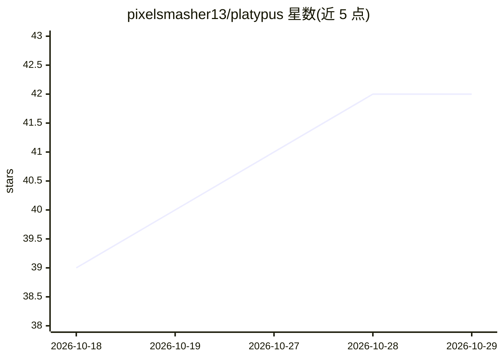

# pixelsmasher13/platypus

⭐ 42 · TypeScript · MIT · 推送 2026-10-05 · [GitHub](https://github.com/pixelsmasher13/platypus) · [官网](https://platypusnotes.com/) · 组织维护

**本地优先的桌面笔记与会议记录应用：录音转写、笔记、文档对话**

基于 Tauri/Rust/React 的开源桌面应用（macOS/Windows）：自动检测 Zoom/Teams 会议并录制麦克风与系统音频（无会议机器人），用本地 Whisper 转写并生成结构化会议笔记；支持笔记整理、PDF/DOCX/URL 导入、按项目向量检索（HNSW）与带行内引用的文档对话，LLM 可接 Claude/OpenAI/Gemini 或本地 Ollama。数据存于本地 SQLite。另可从笔记生成 PowerPoint 幻灯片、跟进邮件与播客音频（ElevenLabs）。源码构建需 Node/Yarn/Rust/cmake，Windows 另需 LLVM。

## 筛选速览

| 维度 | 判定 | 备注 |
|---|---|---|
| AI 角色 | `ai-native` | 本体是模型或模型工具 |
| 许可风险 | `permissive` | MIT |
| 部署形态 | `library` | 以包/库形式分发 |
| 模型依赖 | local-ok | 支持本地模型 |
| 硬件要求 | — | 无带数字的原话,不猜 |
| 安装摩擦 | `low` | 无编译、无系统依赖或容器化 |
| 成熟度 | — | 结构信号不足 |

## 能力要点

- 无机器人录制 Zoom/Teams 并本地 Whisper 转写（含实时草稿）
- 按项目 HNSW 向量检索的 RAG 对话，带可点击行内引用
- LLM 支持 Claude/OpenAI/Gemini 或本地 Ollama，数据存本地 SQLite
- 从笔记生成 PowerPoint 幻灯片（可编辑图表）与播客音频

## 适用场景

- 录制并转写线上会议，自动生成会议纪要
- 把笔记和文档放进一个应用，用对话检索和引用原文
- 数据不出本机的前提下使用 AI 笔记与转录

## 场景标签

`知识库管理` `语音识别` `文档问答` · 领域:知识与检索

## 证据(README 行号)

> L5: An open-source desktop app for taking notes, transcribing meetings, and chatting with your documents. Your notes sta
> L13: - **Capture meetings** — auto-detects Zoom and Teams calls and records your mic plus the meeting audio, no bot requ
> L18: - **Chat with everything you've written** — per-project vector search with Claude, OpenAI, Gemini, or any local Oll

## 星数曲线

2026-10-18 39 → 2026-10-29 42（+3）

---
*卡片 v1 · prompt 1.4 · 生成 2026-10-25 · 置信度 high · 依据 README sha `2e388377ef0b` · [字段定义](../../DATASET.md)*
