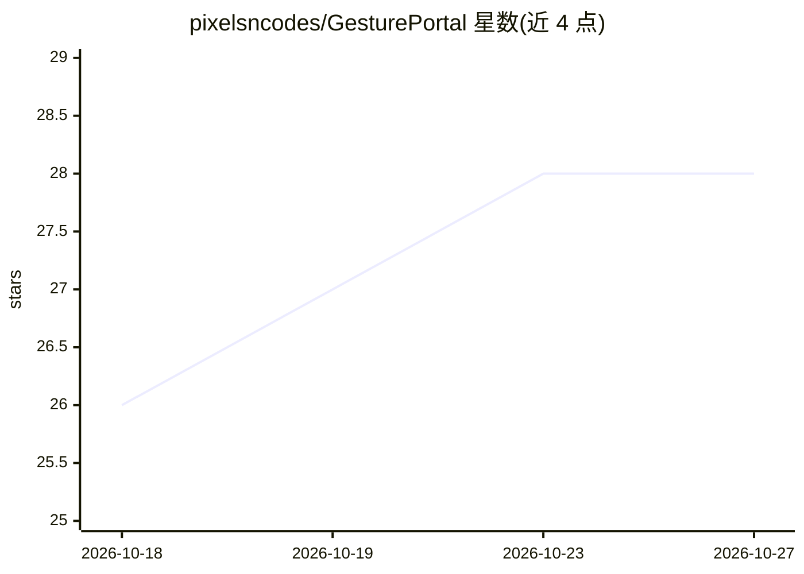

# pixelsncodes/GesturePortal

⭐ 28 · Python · 推送 2026-10-07 · [GitHub](https://github.com/pixelsncodes/GesturePortal) · [官网](https://github.com/pixelsncodes/GesturePortal#see-it-working) · 个人维护

**手势控制本地 AI 摄像头：双手框选窗口揭示风格化画面**

Windows 原型应用：用 MediaPipe 追踪双手，双手比出 L 形取景框时，在摄像头画面上打开可移动窗口，揭示经 ComfyUI 全场景风格化转换的版本，窗口外保持真实画面。AI 转换支持 FLUX.2 Klein 4B 或 Qwen Image 2.1 Turbo 两个模型预设，提供 9 种视觉风格、风格混合、实时/风格化对比与录制保存。推理在本地运行，无需远程 API key；AI 更新速率低于摄像头帧率，权重需单独下载。

## 筛选速览

| 维度 | 判定 | 备注 |
|---|---|---|
| AI 角色 | `ai-native` | 本体是模型或模型工具 |
| 许可风险 | `none` | — |
| 部署形态 | `None` |  |
| 模型依赖 | — | README 未给出锁定关系 |
| 硬件要求 | `gpu-8g` | |
| 安装摩擦 | `medium` | 含编译或系统依赖之一 |
| 成熟度 | `idea` | |

## 能力要点

- 双手 L 形手势生成可移动取景框，控制风格化画面的揭示遮罩
- 全场景风格化由 ComfyUI 执行，支持 FLUX.2 Klein 4B 与 Qwen Image 2.1 Turbo
- 9 种视觉风格预设与风格混合、自定义指令编辑
- 本地内存回环交换视频帧，无远程推理服务或 API key

## 适用场景

- 摄像头画面实时 AI 风格化并用双手手势控制展示区域
- 本地直播/演示中制作动漫、像素画等风格化画面
- 对比真实与 AI 风格化画面并保存对照截图

## 场景标签

`图像生成` · 领域:内容生成

## 证据(README 行号)

> L7: GesturePortal is a local webcam experiment built with Python, MediaPipe and ComfyUI. Hold up two L-shaped hands to o
> L24: - Whole-scene translation with FLUX.2 Klein 4B or Qwen Image 2.1 Turbo.

## 星数曲线

2026-10-18 26 → 2026-10-27 28（+2）

---
*卡片 v1 · prompt 1.4 · 生成 2026-10-26 · 置信度 high · 依据 README sha `12342c56c084` · [字段定义](../../DATASET.md)*
