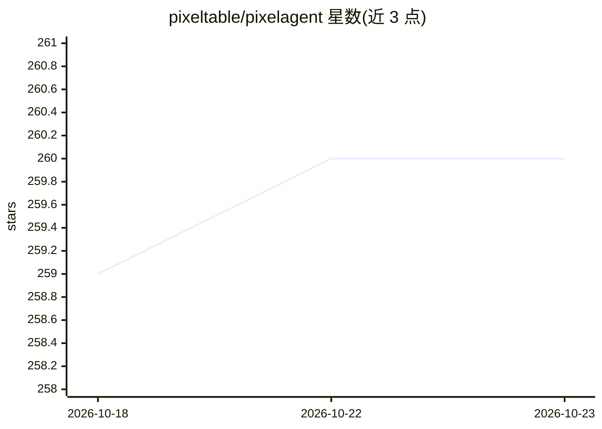

# pixeltable/pixelagent

⭐ 260 · Python · Apache-2.0 · 推送 2026-10-16 · [GitHub](https://github.com/pixeltable/pixelagent) · [官网](https://pixeltable.com) · 组织维护

**给工程师构建多模态有状态 AI agent 的 Python 框架**

Pixeltable 团队开源的 agent 工程框架：把 agent 视为 LLM、存储与编排的交集，基于 Pixeltable 数据基础设施提供声明式类型安全 Python API。chat() 原生支持文本加图像输入，内置 OpenAI/Anthropic/Bedrock/Gemini 四个 provider，消息与工具调用自动持久化到表中，支持自定义工具、长期记忆、反思、推理规划等扩展。0.2.0 要求 Pixeltable >=0.7.15,<0.8 与 Python 3.11+，可配合 Cursor、Windsurf、Cline 等编辑器使用，提供教程与示例目录。

## 筛选速览

| 维度 | 判定 | 备注 |
|---|---|---|
| AI 角色 | `ai-ecosystem` | LLM/agent 周边工具 |
| 许可风险 | `permissive` | Apache-2.0 |
| 部署形态 | `library` | 以包/库形式分发 |
| 模型依赖 | locked-api |  |
| 硬件要求 | — | 无带数字的原话,不猜 |
| 安装摩擦 | `low` | 无编译、无系统依赖或容器化 |
| 成熟度 | — | 结构信号不足 |

## 能力要点

- chat() 原生接收文本与图像的多模态输入
- 消息与工具调用作为观测数据自动存入表格
- 包内内置 OpenAI/Anthropic/Bedrock/Gemini 四个 provider
- 可插拔的工具、长期记忆、反思与规划扩展

## 适用场景

- 构建带持久化记忆与工具调用的自定义 agent
- 实现 ReAct、反思循环、多轮规划等 agent 模式
- 多模态（图文）对话 agent 的原型与部署

## 场景标签

`Agent 框架` `Agent 记忆` `多模态` · 领域:Agent 开发

## 证据(README 行号)

> L21: We see agents as the intersection of an LLM, storage, and orchestration. Pixeltable unifies this interface into a s
> L25: - **Data Orchestration and Storage**: Built on Pixeltable's data infrastructure

## 星数曲线

2026-10-18 259 → 2026-10-23 260（+1）

---
*卡片 v1 · prompt 1.4 · 生成 2026-10-22 · 置信度 high · 依据 README sha `ee1288d6400d` · [字段定义](../../DATASET.md)*
