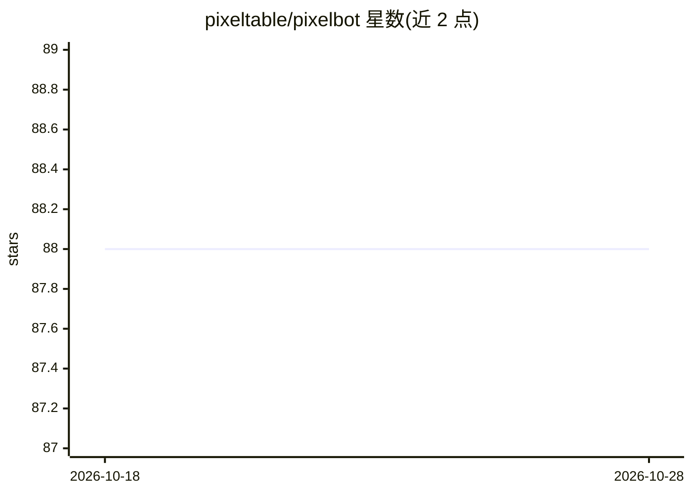

# pixeltable/pixelbot

⭐ 88 · TypeScript · Apache-2.0 · 推送 2026-10-16 · [GitHub](https://github.com/pixeltable/pixelbot) · [官网](https://docs.pixeltable.com/) · 组织维护

**基于 Pixeltable 的本地多模态 AI 应用与数据工作室**

构建在 Pixeltable 0.7.7 之上的本地多模态 AI 应用：单模块 backend/pixelbot/app.py 声明 TableModel schema、Pixeltable 查询路由、自定义 FastAPI API 并捆绑 React 界面。文档、图像、视频、音频、记忆、聊天历史、生成任务、prompt 实验等统一存于 Pixeltable；存储计算列在插入行时执行抽取、分块、转录、生成、检索与工具调用。提供数据库检查器页面查看 catalog、schema、血缘与历史，附有安全边界（上传上限、路径限定、Webhook 白名单）。安装需 Python 3.11–3.14、Node.js 22.12+、uv 及本地媒体工具，从源码构建前后端运行。

## 筛选速览

| 维度 | 判定 | 备注 |
|---|---|---|
| AI 角色 | `ai-native` | 本体是模型或模型工具 |
| 许可风险 | `permissive` | Apache-2.0 |
| 部署形态 | `None` |  |
| 模型依赖 | — | README 未给出锁定关系 |
| 硬件要求 | — | 无带数字的原话,不猜 |
| 安装摩擦 | `low` | 无编译、无系统依赖或容器化 |
| 成熟度 | — | 结构信号不足 |

## 能力要点

- 存储计算列在插入行时执行抽取、分块、转录、生成、检索与工具调用
- Pixeltable 查询路由与 FastAPI 混合 HTTP 层
- 数据库检查器页面：catalog、schema、血缘、历史、计算错误
- 声明式安全边界：上传上限、媒体读取路径限定、Webhook 仅允许启动时配置的 URL

## 适用场景

- 在本地统一管理与检索多模态数据（文档、图像、视频、音频）
- 通过捆绑界面进行聊天、媒体生成与 prompt 实验
- 检查与调试 Pixeltable catalog、schema 与数据血缘

## 场景标签

`聊天机器人` `多模态` `AI 助手` · 领域:对话与助手

## 证据(README 行号)

> L3: Pixelbot 3.0 is a local multimodal AI application built on Pixeltable 0.7.7. One application module, `backend/pixelb
> L5: Pixelbot keeps documents, images, video, audio, memory, chat history, generation jobs, prompt experiments, notificat

## 星数曲线

2026-10-18 88 → 2026-10-28 88（+0）

---
*卡片 v1 · prompt 1.4 · 生成 2026-10-23 · 置信度 high · 依据 README sha `f906d5d096f9` · [字段定义](../../DATASET.md)*
