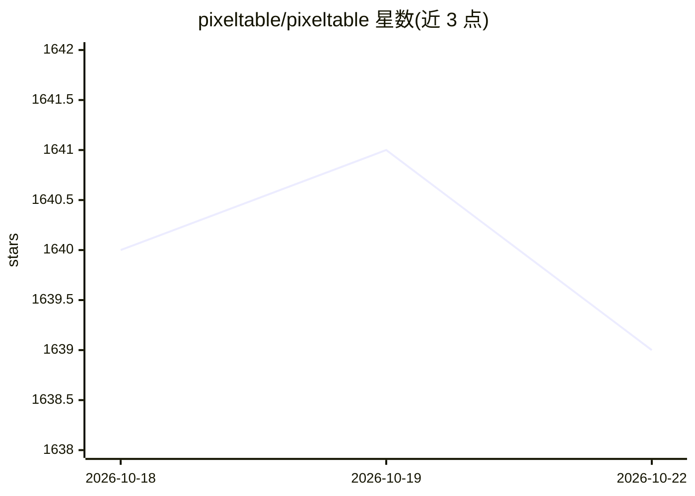

# pixeltable/pixeltable

⭐ 1,640 · Python · Apache-2.0 · 推送 2026-10-22 · [GitHub](https://github.com/pixeltable/pixeltable) · [官网](https://docs.pixeltable.com) · 组织维护

**面向 AI agent 后端的多模态数据库、编排与服务一体框架**

Pixeltable 将多模态数据库、编排与 HTTP 服务整合进单个应用文件：图像、视频、音频、文档存入表，变换是计算列，索引与 HTTP 路由均为声明式；插入一行即触发下游执行，替代对象存储、向量库、编排器与端点代码的组合。提供 pxt CLI（schema/service update）、pip 安装、FastAPI 路由挂载，并支持部署到 Pixeltable Cloud（Limited Beta）。附带面向编码 agent 的 Skill、MCP server 与插件，Apache 2.0 许可。限制：Cloud 为限量测试阶段；/ask 路由需 ANTHROPIC_API_KEY。

## 筛选速览

| 维度 | 判定 | 备注 |
|---|---|---|
| AI 角色 | `ai-ecosystem` | LLM/agent 周边工具 |
| 许可风险 | `permissive` | Apache-2.0 |
| 部署形态 | `library` | 以包/库形式分发 |
| 模型依赖 | — | README 未给出锁定关系 |
| 硬件要求 | — | 无带数字的原话,不猜 |
| 安装摩擦 | `low` | 无编译、无系统依赖或容器化 |
| 成熟度 | `idea` | |

## 能力要点

- 图像/视频/音频/文档列与计算列式的媒体管线
- 声明式索引与 HTTP 路由，插行即触发下游执行
- 单文件可由编码 agent 一次生成，一次 diff 审查
- 提供 Agent Skill、MCP server、Claude/Cursor/ChatGPT 插件

## 适用场景

- 为 AI agent 构建多模态数据管线与检索
- 在一个文件中管理媒体处理、RAG 与 HTTP 服务
- 用编码 agent 自动生成并更新整个后端应用

## 场景标签

`RAG` `向量数据库` `多模态` · 领域:知识与检索

## 证据(README 行号)

> L35: Pixeltable is the database, orchestration, and serving layers. Images, video, audio, and documents live in tables. 
> L99: Inserting into the knowledge table needs no API key. The `/ask` route needs `ANTHROPIC_API_KEY`.

## 星数曲线

2026-10-18 1,640 → 2026-10-22 1,639（-1）

---
*卡片 v1 · prompt 1.4 · 生成 2026-10-21 · 置信度 mid · 依据 README sha `8d27c4b4ceec` · [字段定义](../../DATASET.md)*
