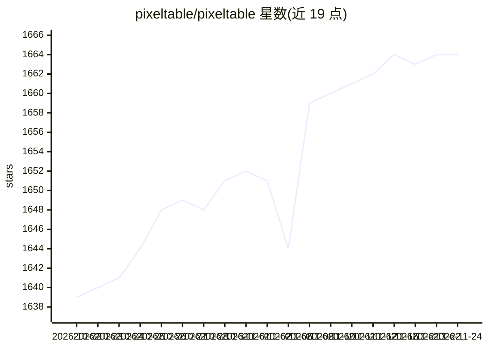

# pixeltable/pixeltable

⭐ 1,664 · Python · Apache-2.0 · 推送 2026-11-22 · [GitHub](https://github.com/pixeltable/pixeltable) · [官网](https://www.pixeltable.com) · 组织维护

**给 AI 应用开发者的多模态数据库：编排、存储与服务合一**

从 Python 使用的开源多模态数据库：在 app.py 中声明表、计算列和 HTTP 路由，插入一行即自动运行计算（如提取音频、转录、摘要、建索引）并存储结果。视频、图像、音频、文档的处理结果与文件引用同表存放，嵌入索引由表维护。提供 pxt CLI 进行初始化、schema 更新、服务启动、错误重算与版本回退。需 Python 3.11+，模型调用依赖外部 provider 的 API key；不改变模型本身的质量，评估由用户自行管理。

## 筛选速览

| 维度 | 判定 | 备注 |
|---|---|---|
| AI 角色 | `ai-ecosystem` | LLM/agent 周边工具 |
| 许可风险 | `permissive` | Apache-2.0 |
| 部署形态 | `library` | 以包/库形式分发 |
| 模型依赖 | — | README 未给出锁定关系 |
| 硬件要求 | — | 无带数字的原话,不猜 |
| 安装摩擦 | `low` | 无编译、无系统依赖或容器化 |
| 成熟度 | — | 结构信号不足 |

## 能力要点

- 声明式表与计算列：插入行即触发模型调用、存储与索引更新
- 工具调用与结果作为行内列存储，支持跨会话记忆表
- 失败单元格保留错误并可用 pxt recompute --errors-only 重算
- 每次变更为版本，支持 history() 与 pxt revert 回退

## 适用场景

- 对文档集合做 RAG，文档增删时自动更新分块与嵌入
- 搭建视频/图像流水线，管理帧、转录与检测结果
- 构建 agent 应用，把工具调用与结果存为可查询的列
- 替换自维护的 bucket+元数据库+向量库同步脚本

## 场景标签

`RAG` `多模态` `图像视频处理` · 领域:知识与检索

## 证据(README 行号)

> L7: Pixeltable is an open-source multimodal database you use from Python. Build AI apps on video, images, audio and docu
> L29: You declare tables, computed columns and HTTP routes in `app.py`. Insert a row and Pixeltable runs the computations
> L93: |Let an agent call tools|An agent loop that keeps its state in memory|A computed column runs the tools the model pi

## 星数曲线

2026-10-22 1,639 → 2026-11-24 1,664（+25）

---
*卡片 v1 · prompt 1.4 · 生成 2026-11-23 · 置信度 mid · 依据 README sha `bfad1d7b2041` · [字段定义](../../DATASET.md)*
