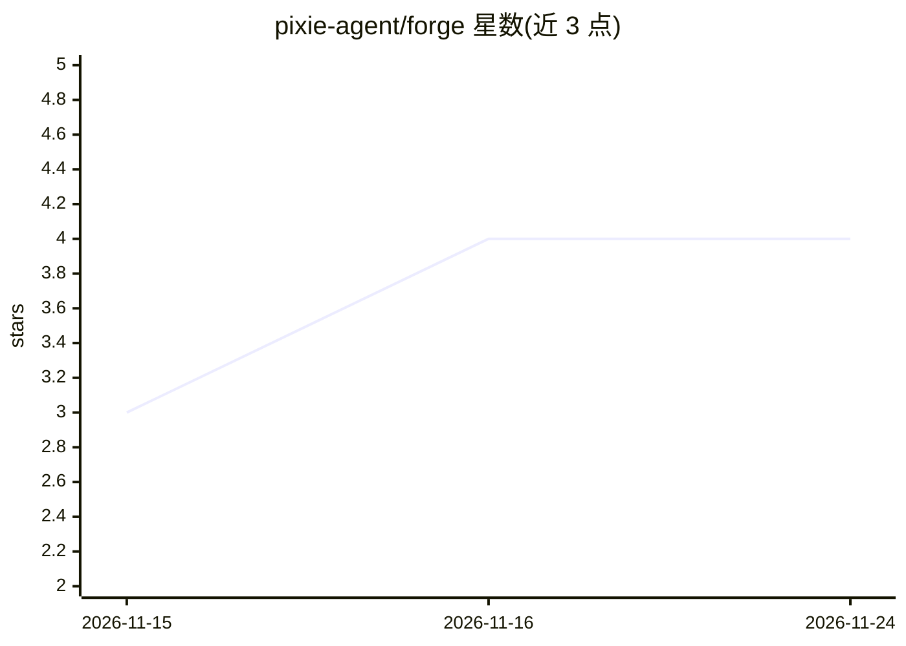

# pixie-agent/forge

⭐ 4 · TypeScript · NOASSERTION · 推送 2026-11-20 · [GitHub](https://github.com/pixie-agent/forge) · [官网](https://app.1forgen.site) · 组织维护 · 中文 README

**面向用户用自然语言生成多文件 React 应用的开源 AI 平台**

由 Pixie Agent 维护的 AI 应用生成与托管平台：用户以自然语言描述需求，pi coding agent 在隔离工作区中规划、编写并构建多文件 React 应用（含 D1/KV/R2/Durable Object 后端），Cloudflare Worker 负责账户、任务、数据与发布。支持对话式编辑、流式进度输出、版本历史、一键发布与源码导出，带 11 种语言界面与管理控制台。平台源码为 PolyForm Noncommercial 许可，仅限非商业用途。

## 筛选速览

| 维度 | 判定 | 备注 |
|---|---|---|
| AI 角色 | `ai-native` | 本体是模型或模型工具 |
| 许可风险 | `none` | NOASSERTION |
| 部署形态 | `library` | 以包/库形式分发 |
| 模型依赖 | — | README 未给出锁定关系 |
| 硬件要求 | — | 无带数字的原话,不猜 |
| 安装摩擦 | `low` | 无编译、无系统依赖或容器化 |
| 成熟度 | `idea` | |

## 能力要点

- 自然语言生成与对话式编辑多文件 React 应用
- 生成应用内置真实后端（D1/KV/R2/Durable Object SQLite）
- 实时流式输出规划、代码变更与构建进度，SSE 自动降级为轮询
- 支持失败断点恢复、图像/文本附件与源码导出

## 适用场景

- 用自然语言快速生成带后端的 React 应用并发布上线
- 自托管一套 AI 应用生成平台
- 面向生成的应用接入 GA4、Stripe 连接器

## 场景标签

`代码生成` `编码 Agent` · 领域:编码与开发

## 证据(README 行号)

> L5: Forge is an AI application generation and hosting platform maintained by Pixie Agent. Users describe what they want 
> L16: - D1 for platform metadata, R2 for build artifacts, KV, plus per-project × per-environment Durable Object SQLite
> L49: - A model service compatible with the OpenAI, Anthropic Messages or OpenAI Responses dialect

## 星数曲线

2026-11-15 3 → 2026-11-24 4（+1）

---
*卡片 v1 · prompt 1.4 · 生成 2026-11-21 · 置信度 high · 依据 README sha `b92028932dfe` · [字段定义](../../DATASET.md)*
