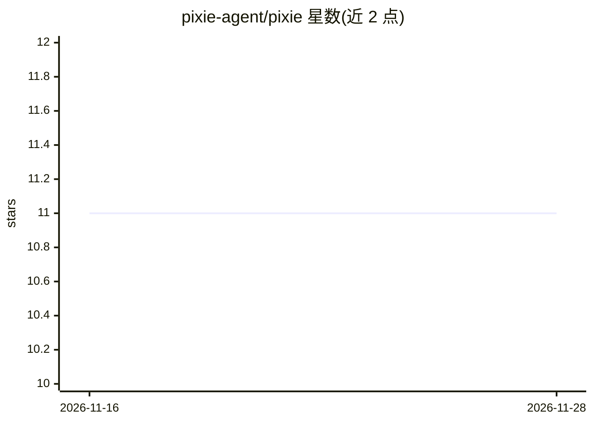

# pixie-agent/pixie

⭐ 11 · Rust · MIT · 推送 2026-11-15 · [GitHub](https://github.com/pixie-agent/pixie) · 个人维护 · 中文 README

**可插拔 agent CLI 的桌面工作台：多会话并行与知识库**

基于 Tauri v2（Rust 后端 + React/TypeScript 前端）的桌面应用，本身不内置模型或 API 客户端，而是启动外部 agent CLI 进程、流式解析其 NDJSON 输出并渲染为原生界面。每个会话绑定一个引擎（当前支持 Claude Code、Cursor Agent、CodeBuddy），可在多工作区并行运行；提供定时任务、每引擎独立的 API key/模型配置、以及将对话摘要为 Obsidian 兼容笔记并做 BM25+jieba 分词检索的知识库。使用前需自行安装并认证至少一个 agent CLI。

## 筛选速览

| 维度 | 判定 | 备注 |
|---|---|---|
| AI 角色 | `ai-ecosystem` | LLM/agent 周边工具 |
| 许可风险 | `permissive` | MIT |
| 部署形态 | `library` | 以包/库形式分发 |
| 模型依赖 | — | README 未给出锁定关系 |
| 硬件要求 | — | 无带数字的原话,不猜 |
| 安装摩擦 | `low` | 无编译、无系统依赖或容器化 |
| 成熟度 | — | 结构信号不足 |

## 能力要点

- 按会话切换引擎，多工作区多会话并行流式运行
- 内置 BM25 知识库（jieba CJK 分词），笔记可注入 agent 上下文
- 定时任务无人值守运行并推送桌面通知
- 遵循 Claude agent 标准（SKILL.md、插件市场、/skill 调用）

## 适用场景

- 把已有 Claude Code / Cursor CLI 包进统一桌面界面管理多项目
- 对任意文件夹定时无人值守运行 agent 提示词
- 把历史对话沉淀为可检索笔记并回灌给 agent 做上下文

## 场景标签

`编码 Agent` `知识库管理` · 领域:编码与开发

## 证据(README 行号)

> L14: Pixie is a thin, fast desktop shell for **agent CLIs you already have installed**. It does not ship its own model o
> L16: Each conversation binds to an **engine** (today: Claude Code, Cursor Agent, or CodeBuddy). You can mix engines acro

## 星数曲线

2026-11-16 11 → 2026-11-28 11（+0）

---
*卡片 v1 · prompt 1.4 · 生成 2026-11-18 · 置信度 high · 依据 README sha `47dca471e96a` · [字段定义](../../DATASET.md)*
