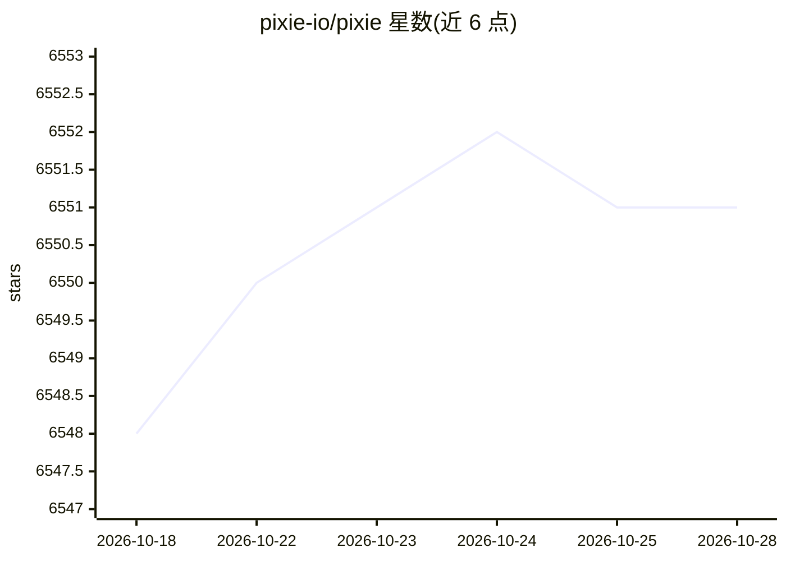

# pixie-io/pixie

⭐ 6,552 · C++ · Apache-2.0 · 推送 2026-10-26 · [GitHub](https://github.com/pixie-io/pixie) · [官网](https://px.dev) · 组织维护

**面向 Kubernetes 应用的 eBPF 自动遥测观测工具**

Pixie 是 CNCF 沙箱项目（由 New Relic 贡献）的开源 Kubernetes 应用观测工具。基于 eBPF 自动采集全量请求体、网络与资源指标、应用性能剖析等遥测数据，数据在集群内本地采集、存储与查询（占用集群 CPU 低于 5%）。提供 PxL 类 Python 查询语言，可通过 Web UI、CLI 与 API 使用；功能覆盖网络监控、基础设施健康、服务性能、数据库查询剖析、请求追踪、持续性能剖析、分布式 bpftrace 部署与动态 Go 日志。Apache 2.0 许可。

## 筛选速览

| 维度 | 判定 | 备注 |
|---|---|---|
| AI 角色 | `ai-enhanced` | 去掉 AI 部分产品仍成立 |
| 许可风险 | `permissive` | Apache-2.0 |
| 部署形态 | `None` |  |
| 模型依赖 | — | README 未给出锁定关系 |
| 硬件要求 | — | 无带数字的原话,不猜 |
| 安装摩擦 | `low` | 无编译、无系统依赖或容器化 |
| 成熟度 | — | 结构信号不足 |

## 能力要点

- eBPF 自动采集全量请求体、指标与性能剖析，无需手动插桩
- 遥测数据在集群内本地存储与查询（CPU 占用低于 5%）
- PxL 类 Python 查询语言，跨 UI/CLI/API 使用
- 支持分布式 bpftrace 部署与免重编译的动态 Go 日志

## 适用场景

- 排查微服务间请求流转与慢请求
- 监控集群网络流量、DNS 与 TCP 丢包/重传
- 分析数据库查询延迟与吞吐
- 持续剖析应用代码性能问题

## 场景标签

 · 领域:云原生/可观测性

## 证据(README 行号)

> L17: Pixie is an open-source observability tool for Kubernetes applications. Use Pixie to view the high-level state of y
> L23: - **Auto-telemetry:** Pixie uses eBPF to automatically collect telemetry data such as full-body requests, resource 

## 星数曲线

2026-10-18 6,548 → 2026-10-28 6,551（+3）

---
*卡片 v1 · prompt 1.4 · 生成 2026-10-20 · 置信度 low · 依据 README sha `c6cf5e984173` · [字段定义](../../DATASET.md)*
