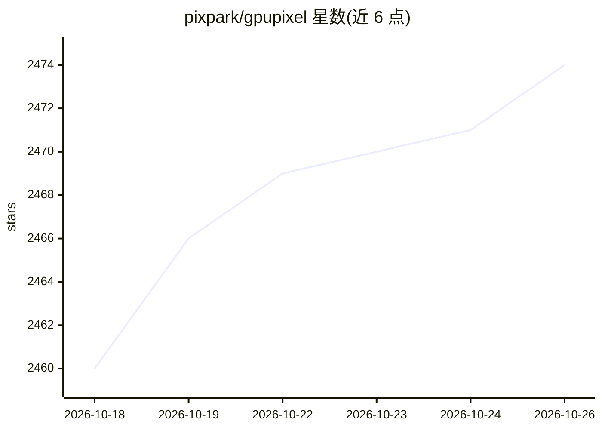

# pixpark/gpupixel

⭐ 2,474 · C++ · Apache-2.0 · 推送 2026-09-26 · [GitHub](https://github.com/pixpark/gpupixel) · [官网](https://gpupixel.pixpark.net/) · 组织维护 · 中文 README

**跨平台 C++/OpenGL 实时图像视频美颜滤镜库**

基于 C++11 与 OpenGL/ES 构建的图像与视频滤镜库，提供美颜滤镜，支持 iOS、Android、Mac、Windows、Linux 及任何 OpenGL/ES 平台。README 本体不包含具体构建命令，安装与集成方式通过外部文档（Introduction | Build | Demo | Integration）给出。参考 GPUImage、GPUImage-x、CainCamera 项目，采用 Apache-2.0 许可证发布。面向需要美颜/滤镜能力的移动与桌面应用开发者。

## 筛选速览

| 维度 | 判定 | 备注 |
|---|---|---|
| AI 角色 | `ai-enhanced` | 去掉 AI 部分产品仍成立 |
| 许可风险 | `permissive` | Apache-2.0 |
| 部署形态 | `None` |  |
| 模型依赖 | — | README 未给出锁定关系 |
| 硬件要求 | — | 无带数字的原话,不猜 |
| 安装摩擦 | `low` | 无编译、无系统依赖或容器化 |
| 成熟度 | — | 结构信号不足 |

## 能力要点

- 基于 C++11 与 OpenGL/ES 构建
- 支持 iOS、Android、Mac、Windows、Linux 等跨平台
- 提供美颜（beauty face）滤镜效果
- 兼容任何 OpenGL/ES 平台

## 适用场景

- 在直播或相机 App 中加入美颜滤镜
- 跨平台视频/图像实时滤镜处理
- 移动端人脸滤镜效果开发

## 场景标签

`图像视频处理` · 领域:感知与多模态

## 证据(README 行号)

> L20: GPUPixel is a high-performance, cross-platform image and video filter library with a small footprint. Built with C+

## 星数曲线

2026-10-18 2,460 → 2026-10-26 2,474（+14）

---
*卡片 v1 · prompt 1.4 · 生成 2026-10-21 · 置信度 mid · 依据 README sha `2a895ef68c85` · [字段定义](../../DATASET.md)*
