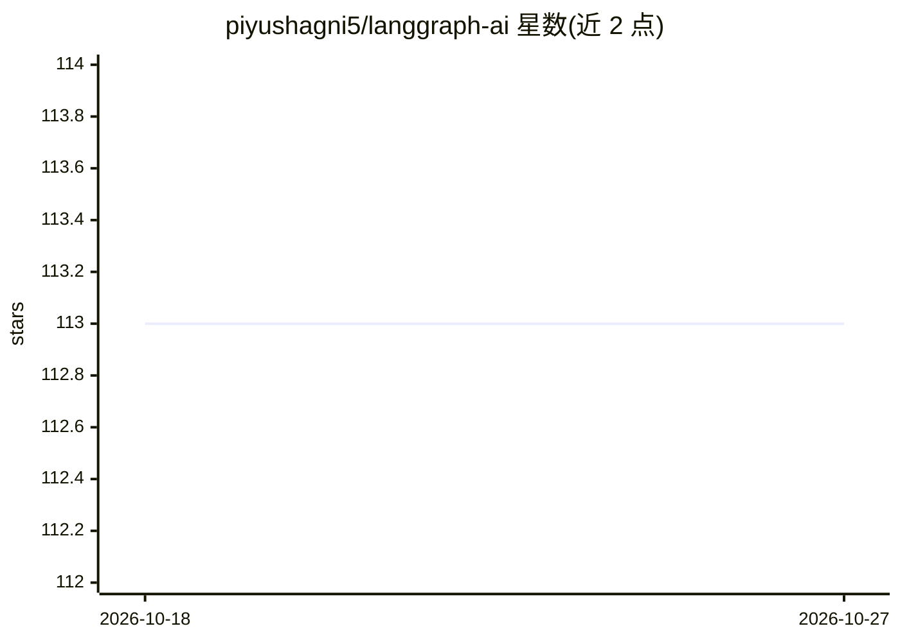

# piyushagni5/langgraph-ai

⭐ 113 · Jupyter Notebook · MIT · 推送 2026-01-11 · [GitHub](https://github.com/piyushagni5/langgraph-ai) · [官网](https://medium.com/@piyushagni5) · 个人维护

**LangGraph 实现与教程合集：Agentic RAG、MCP、工作流模式**

汇集基于 LangGraph 的实现示例、教程与工作流模式，内容覆盖 Agentic RAG（含自适应路由与自我修正）、MCP 服务端/客户端实现、复杂 AI 工作流编排、人机协同系统与高级 RAG Agent。面向构建 AI 应用的开发者，作为实现参考指南使用。仓库按目录组织多个独立子项目，通过 git clone 获取，使用 UV 或 pip 创建虚拟环境并按子项目安装 requirements.txt 依赖，需在 .env 中配置 ANTHROPIC_API_KEY 等 API key 后用 uv run 运行，MIT 许可。

## 筛选速览

| 维度 | 判定 | 备注 |
|---|---|---|
| AI 角色 | `ai-knowledge` | 知识聚合/清单类 |
| 许可风险 | `permissive` | MIT |
| 部署形态 | `library` | 以包/库形式分发 |
| 模型依赖 | — | README 未给出锁定关系 |
| 硬件要求 | — | 无带数字的原话,不猜 |
| 安装摩擦 | `low` | 无编译、无系统依赖或容器化 |
| 成熟度 | — | 结构信号不足 |

## 能力要点

- Agentic RAG 系统（自适应路由与自我修正机制）示例
- MCP（Model Context Protocol）服务端与客户端完整实现
- 复杂 AI 工作流编排与人机协同模式示例
- 提供 UV/pip 安装流程与 pytest 测试运行方式

## 适用场景

- 学习用 LangGraph 构建 Agentic RAG 系统
- 参考 MCP 服务端与客户端的实现模式
- 为复杂 AI 工作流编排寻找实现范例

## 场景标签

`教程课程` `RAG` · 领域:知识与检索

## 证据(README 行号)

> L3: A comprehensive collection of LangGraph implementations, tutorials, and advanced AI workflows covering Agentic RAG s
> L7: This repository serves as a implementation guide for building sophisticated AI applications using LangGraph. It cont

## 星数曲线

2026-10-18 113 → 2026-10-27 113（+0）

---
*卡片 v1 · prompt 1.4 · 生成 2026-10-23 · 置信度 mid · 依据 README sha `124fa833cfd0` · [字段定义](../../DATASET.md)*
