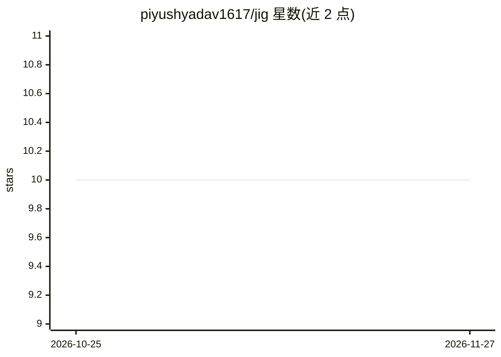

# piyushyadav1617/jig

⭐ 10 · TypeScript · 推送 2026-11-23 · [GitHub](https://github.com/piyushyadav1617/jig) · [官网](https://piyushyadav1617.github.io/jig/) · 个人维护

**终端内的 AI 编码 agent：读取文件、改代码、执行命令**

jig 是运行在终端的 AI 编码 agent：用户给出任务后，它会读取项目文件、做出修改并运行命令。默认内置模型可用，也可通过 /providers 命令连接自带 provider 并填入 API key，支持 /models 选择模型、/clear 重置对话、/esc 中止当前任务且保留已完成的修改。macOS/Linux 通过一行 shell 脚本安装，开发者需 Bun 环境进行本地开发。

## 筛选速览

| 维度 | 判定 | 备注 |
|---|---|---|
| AI 角色 | `ai-native` | 本体是模型或模型工具 |
| 许可风险 | `none` | — |
| 部署形态 | `None` |  |
| 模型依赖 | — | README 未给出锁定关系 |
| 硬件要求 | — | 无带数字的原话,不猜 |
| 安装摩擦 | `low` | 无编译、无系统依赖或容器化 |
| 成熟度 | — | 结构信号不足 |

## 能力要点

- 终端交互式编码 agent：读文件、改代码、运行命令
- 支持接入自定义 provider（API key）与模型选择
- 任务可随时中止，已做修改保留
- 提供 /models、/providers、/clear 等内置命令

## 适用场景

- 让 AI 解释一个陌生项目的工作方式
- 让 AI 修复失败的测试
- 让 AI 在项目中添加一个健康检查 endpoint

## 场景标签

`编码 Agent` · 领域:编码与开发

## 证据(README 行号)

> L5: An AI coding agent for your terminal. Give it a task and watch it read files,
> L33: Use the included model, or type `/providers` to connect your own provider with

## 星数曲线

2026-10-25 10 → 2026-11-27 10（+0）

---
*卡片 v1 · prompt 1.4 · 生成 2026-11-19 · 置信度 high · 依据 README sha `7c3179e597b2` · [字段定义](../../DATASET.md)*
