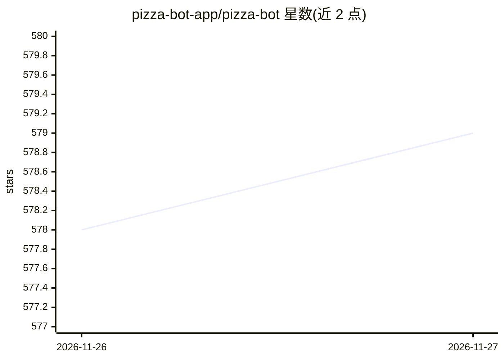

# pizza-bot-app/pizza-bot

⭐ 579 · TypeScript · Apache-2.0 · 推送 2026-11-26 · [GitHub](https://github.com/pizza-bot-app/pizza-bot) · [官网](https://github.com/pizza-bot-app/pizza-bot/releases) · 组织维护

**本地优先的 AI 长任务收件箱：离开后任务继续跑、回来验收**

面向需要长时间运行 AI 任务的用户提供的本地收件箱应用：任务启动或定时触发后，客户端断开仍继续执行（checkpoint 续跑），完成结果进入 Unread 队列、待审批决策进入 Action 队列，并支持 cron/webhook 触发、技能子代理委派与 human-in-the-loop 审批。Electron 桌面、浏览器与 CLI 三种前端均通过 HTTP/SSE 连接 api-server。数据默认存于本地，需 Node.js 24+，运行需配置至少一个模型供应商。

## 筛选速览

| 维度 | 判定 | 备注 |
|---|---|---|
| AI 角色 | `ai-native` | 本体是模型或模型工具 |
| 许可风险 | `permissive` | Apache-2.0 |
| 部署形态 | `desktop` | 安装包/桌面程序 |
| 模型依赖 | local-ok | 支持本地模型 |
| 硬件要求 | — | 无带数字的原话,不猜 |
| 安装摩擦 | `low` | 无编译、无系统依赖或容器化 |
| 成熟度 | — | 结构信号不足 |

## 能力要点

- 断开后任务继续运行，checkpoint 恢复与 cron/webhook 触发
- Unread/Action 双队列管理完成工作与审批请求
- 技能封装为工具受限的子代理，进度在 Activity 面板展示
- 支持 Amazon Bedrock、Anthropic、Gemini、OpenAI 等 12 个模型供应商接入

## 适用场景

- 启动长耗时 AI 任务后离开，回来在收件箱验收结果
- 对涉及本地文件写入等关键操作设置人工审批
- 把线程分文件夹组织，同时保留全局待办队列

## 场景标签

`工作流自动化` `AI 助手` · 领域:效率与自动化

## 证据(README 行号)

> L5:  A local-first inbox for long-running AI work.
> L45: - **Bring your model provider.** Amazon Bedrock, Anthropic, Google Gemini,
> L97: A running api-server needs access to at least one model provider; HTTP clients

## 星数曲线

2026-11-26 578 → 2026-11-27 579（+1）

---
*卡片 v1 · prompt 1.4 · 生成 2026-11-27 · 置信度 high · 依据 README sha `9e837c7de0c0` · [字段定义](../../DATASET.md)*
