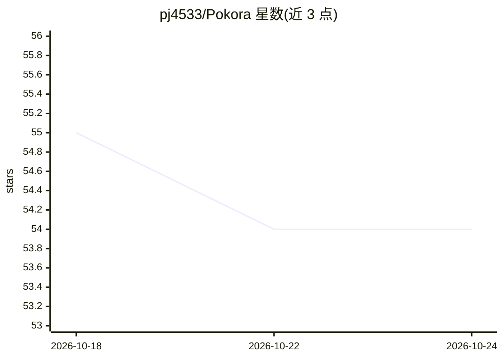

# pj4533/Pokora

⭐ 54 · Swift · MIT · 推送 2025-12-29 · [GitHub](https://github.com/pj4533/Pokora) · 个人维护

**本地 Stable Diffusion 视频 AI 创作平台（macOS SwiftUI 应用）**

macOS 原生 SwiftUI 视频创作应用：读取本地视频，抽取帧并用 Stable Diffusion（CoreML 格式模型）做图生图处理，支持 prompt、seed、strength 及强度插值，提供 Direct、Generative、Audio Reactive 三种效果类型，渲染后与原始帧、原音频合成为新视频导出。完全本地运行，无需联网。模型需自行转换为 CoreML 格式（基于 ml-stable-diffusion v0.4.0），ControlNet 支持为单模型开关式。需从 Xcode 源码构建，渲染耗时可能以小时计。

## 筛选速览

| 维度 | 判定 | 备注 |
|---|---|---|
| AI 角色 | `ai-native` | 本体是模型或模型工具 |
| 许可风险 | `permissive` | MIT |
| 部署形态 | `None` |  |
| 模型依赖 | — | README 未给出锁定关系 |
| 硬件要求 | — | 无带数字的原话,不猜 |
| 安装摩擦 | `low` | 无编译、无系统依赖或容器化 |
| 成熟度 | `idea` | |

## 能力要点

- 视频帧经 Stable Diffusion 图生图处理后与原音频合成导出
- Direct/Generative/Audio Reactive 三种效果类型（音频响应按振幅阈值触发强度包络）
- 完全本地运行，无需联网
- ControlNet 单模型基础支持与 RealESRGAN 放大

## 适用场景

- 为已有视频片段叠加 AI 生成的风格化效果
- 制作随音量起伏变化的音频响应视觉特效
- 在 Mac 上离线生成 AI 处理的视频并保留原音频

## 场景标签

`图像生成` `视频生成` · 领域:内容生成

## 证据(README 行号)

> L8: Pokora is a video creation platform that combines existing video clips with AI generated video clips, using Stable D
> L15: - Process frames using Stable Diffusion (prompt, seed, strength) ✅

## 星数曲线

2026-10-18 55 → 2026-10-24 54（-1）

---
*卡片 v1 · prompt 1.4 · 生成 2026-10-24 · 置信度 high · 依据 README sha `7ac97c85c8e8` · [字段定义](../../DATASET.md)*
