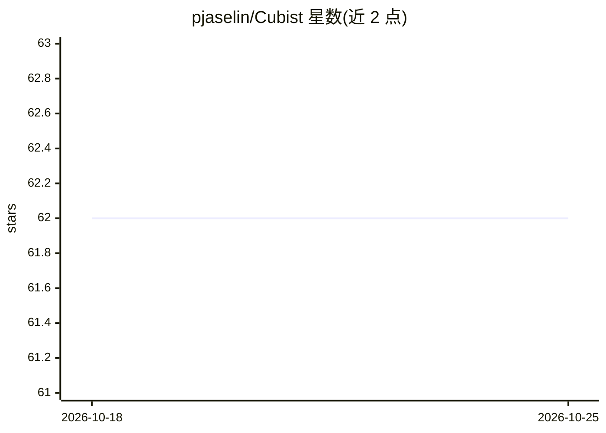

# pjaselin/Cubist

⭐ 62 · C · GPL-3.0 · 推送 2026-05-31 · [GitHub](https://github.com/pjaselin/Cubist) · [官网](https://pjaselin.github.io/Cubist/) · 个人维护

**Quinlan Cubist 规则回归模型的 Python 封装**

Python 包，封装 Ross Quinlan 的 Cubist v2.07 规则回归模型，并以 scikit-learn estimator 形式暴露。模型生成条件规则集合与对应线性回归器的分段模型，支持可选的近邻修正、缺失值处理、交叉验证、多模型 committees 降低误差与外推。额外提供可视化工具（需安装 viz 扩展），用于探查线性回归器系数与规则覆盖度。部分原模型特性未在本包中完整启用，包内自行标注。

## 筛选速览

| 维度 | 判定 | 备注 |
|---|---|---|
| AI 角色 | `ai-native` | 本体是模型或模型工具 |
| 许可风险 | `viral` | GPL-3.0 |
| 部署形态 | `library` | 以包/库形式分发 |
| 模型依赖 | — | README 未给出锁定关系 |
| 硬件要求 | — | 无带数字的原话,不猜 |
| 安装摩擦 | `low` | 无编译、无系统依赖或容器化 |
| 成熟度 | — | 结构信号不足 |

## 能力要点

- Cubist v2.07 规则回归的 Python/scikit-learn estimator 封装
- 支持缺失值处理、交叉验证、committees 多模型与外推
- 可选 viz 扩展提供系数与规则覆盖度可视化
- 兼容 scikit-learn 接口设计

## 适用场景

- 用可解释的规则回归模型做数值预测
- 在 scikit-learn 工作流中使用 Cubist 模型
- 分析训练模型的规则覆盖与回归系数

## 场景标签

 · 领域:机器学习/回归建模

## 证据(README 行号)

> L11: `cubist` is a Python package and wrapper for Ross Quinlan's Cubist v2.07 rule-based regression model with additiona
> L21: - Generates a piecewise model formulated as a collection of conditional rules with corresponding linear regressors 

## 星数曲线

2026-10-18 62 → 2026-10-25 62（+0）

---
*卡片 v1 · prompt 1.4 · 生成 2026-10-24 · 置信度 high · 依据 README sha `747bf8191a23` · [字段定义](../../DATASET.md)*
