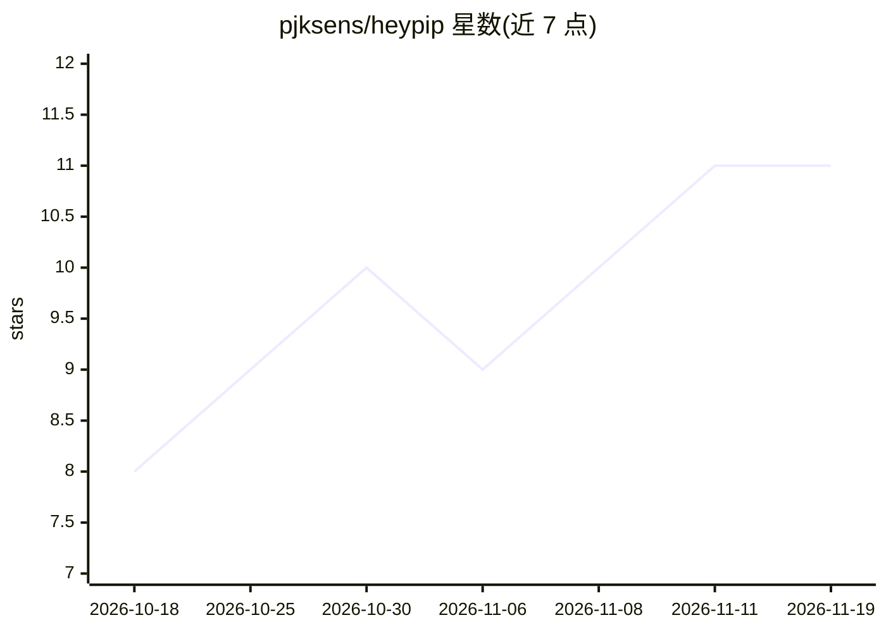

# pjksens/heypip

⭐ 11 · Swift · MIT · 推送 2026-10-15 · [GitHub](https://github.com/pjksens/heypip) · [官网](https://sachapraljak.com/?utm_source=github&utm_medium=repo&utm_campaign=heypip) · 个人维护

**Mac 刘海实时会议转录工具，把对话喂给你的 AI agent**

驻留在 MacBook 刘海处的菜单栏式应用：在 Google Meet、Zoom、Teams 通话中用 Apple 语音识别逐句转录「你」与「对方」两路音频（延迟 1–3 秒），将对话写入会议文件夹的 agent-feed.md，供 Claude Code 等可读写文件的 agent 监听并回写建议到 notes.md；也提供 /pip 技能命令与事后总结。支持暂停、词表定制、自动更新。要求 macOS 15+，无账号无服务器。

## 筛选速览

| 维度 | 判定 | 备注 |
|---|---|---|
| AI 角色 | `ai-native` | 本体是模型或模型工具 |
| 许可风险 | `permissive` | MIT |
| 部署形态 | `desktop` | 安装包/桌面程序 |
| 模型依赖 | locked-api |  |
| 硬件要求 | — | 无带数字的原话,不猜 |
| 安装摩擦 | `low` | 无编译、无系统依赖或容器化 |
| 成熟度 | — | 结构信号不足 |

## 能力要点

- Apple 语音识别本地逐句转录，「你/对方」分轨记录
- 通过 agent-feed.md/notes.md 文件协议对接任意 agent
- 提供 Claude Code 的 /pip 技能安装命令
- macOS 26 使用 SpeechAnalyzer，macOS 15 上不保证完全本地转录

## 适用场景

- 视频会议中让 agent 实时提示下一个问题与决策依据
- 通话结束后自动生成会议摘要与跟进邮件
- 关闭 agent 仅用作本地隐私转录工具

## 场景标签

`语音识别` · 领域:感知与多模态

## 证据(README 行号)

> L18: **Pip lives in your MacBook's notch and brings your AI agent into your meetings.** During a video call, a client
> L56: - **Live, on your Mac.** Apple's speech recognition, sentence by sentence, 1–3 s after it is said. On macOS 26 no a
> L102: |`agent-feed.md`|the same lines, only while the agent is on. **This is the file your agent follows.**|

## 星数曲线

2026-10-18 8 → 2026-11-19 11（+3）

---
*卡片 v1 · prompt 1.4 · 生成 2026-11-18 · 置信度 high · 依据 README sha `2107b4365dc0` · [字段定义](../../DATASET.md)*
