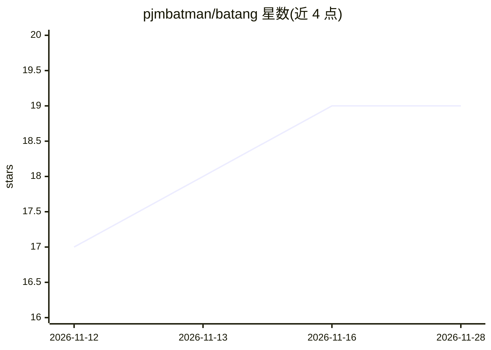

# pjmbatman/batang

⭐ 19 · Python · NOASSERTION · 推送 2026-11-13 · [GitHub](https://github.com/pjmbatman/batang) · [官网](https://batanghub.com) · 个人维护 · 中文 README

**电池研究一体化平台：数据、数字孪生与无代码 AI 建模**

面向电池研究全流程的统一平台：将 43 个老化数据集（3,400 个电芯）与 11 个设备数据集（1,513 台设备）转换为统一 schema，支持 PyBaMM（SPM/SPMe/DFN）与 Neural P2D 仿真并通过 P2D 数字孪生可视化回放；提供无代码 AI 建模（模块拼装网络、GPU 训练、导出 PyTorch 代码）。每一步可通过研究助理 Batangi 以自然语言完成，外部助手（如 Claude）可经 MCP 访问数据。使用需在 batanghub.com 注册账号，数据保留原许可，client/ 目录提供 MIT 许可的 Python 下载包。

## 筛选速览

| 维度 | 判定 | 备注 |
|---|---|---|
| AI 角色 | `ai-enhanced` | 去掉 AI 部分产品仍成立 |
| 许可风险 | `none` | NOASSERTION |
| 部署形态 | `None` |  |
| 模型依赖 | — | README 未给出锁定关系 |
| 硬件要求 | — | 无带数字的原话,不猜 |
| 安装摩擦 | `low` | 无编译、无系统依赖或容器化 |
| 成熟度 | — | 结构信号不足 |

## 能力要点

- 3,400 个电芯（锂/钠/锌离子）统一 schema，共 17.0 G 样本
- PyBaMM SPM/SPMe/DFN 与 Neural P2D（DFN 的 GPU 代理）仿真，43 组参数集
- 无代码 AI 建模：模块拼装网络并在 GPU 上训练，导出 PyTorch 代码
- 研究助理 Batangi 自然语言交互；外部助手可经 MCP 访问数据

## 适用场景

- 在统一平台完成电池数据的加载、标准化与探索分析
- 对特定电芯运行 DFN/Neural P2D 仿真并可视化回放
- 不写代码地训练电池退化预测模型并导出 PyTorch 代码
- 通过对话让研究助理查数据、画图并配置仿真

## 场景标签

`科研工具` `数据分析` · 领域:效率与自动化

## 证据(README 行号)

> L21: **Batang** (바탕, *foundation*) is **one hub** for the whole battery research pipeline, made to be used
> L46:  One hub: Database (real cells, their raw files flying into one Parquet store, explored as SOH trajectories, yours 
> L53: |💬 **AI assistant**|Batangi finds data, draws charts in the chat and opens the right screen, set up for you. Your o

## 星数曲线

2026-11-12 17 → 2026-11-28 19（+2）

---
*卡片 v1 · prompt 1.4 · 生成 2026-11-18 · 置信度 high · 依据 README sha `f67ea4b7a1ac` · [字段定义](../../DATASET.md)*
